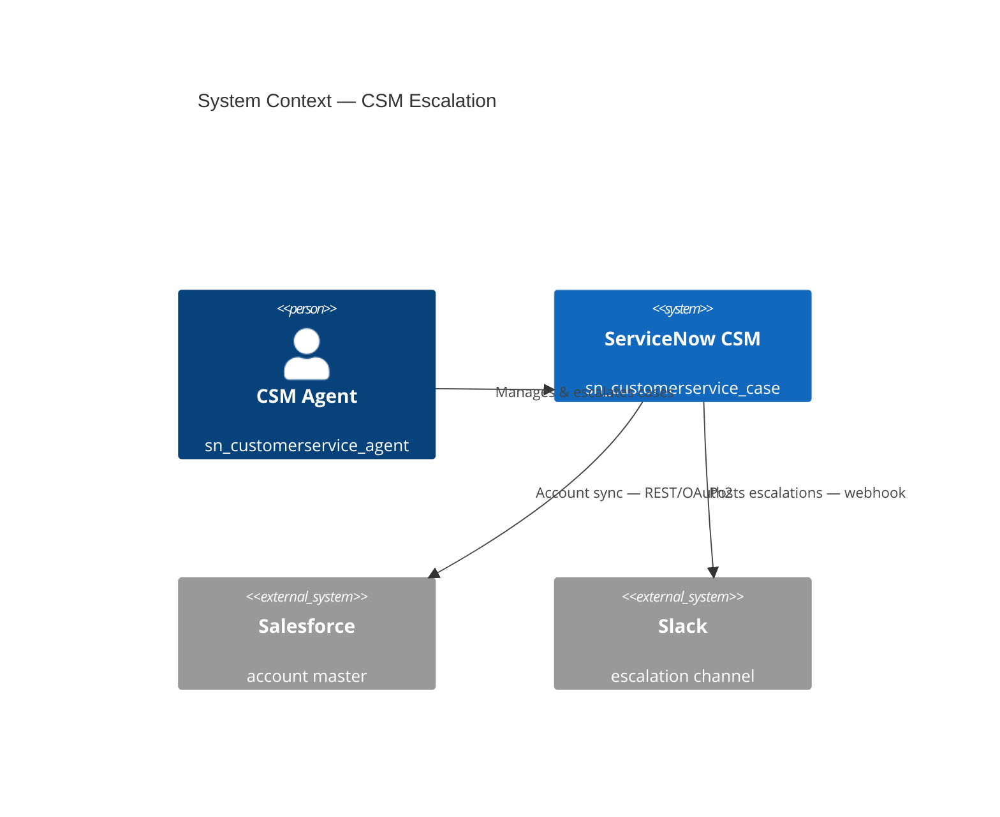
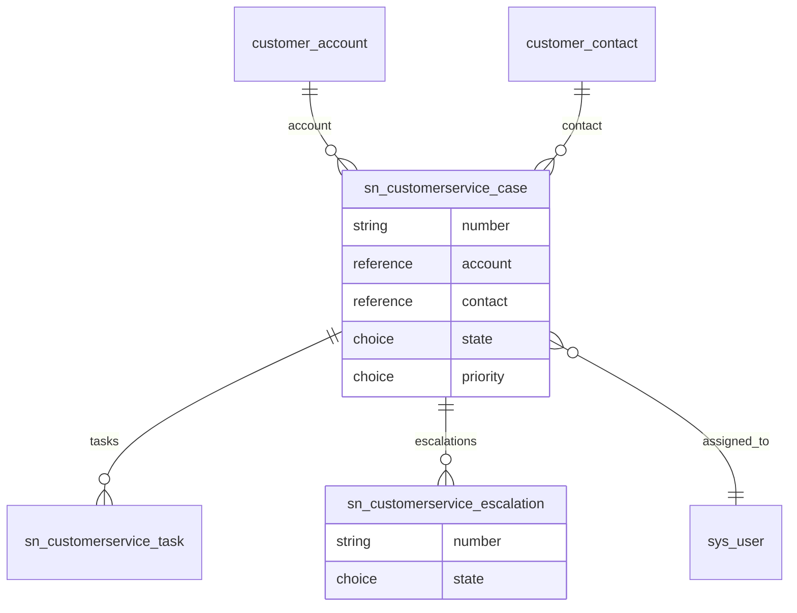
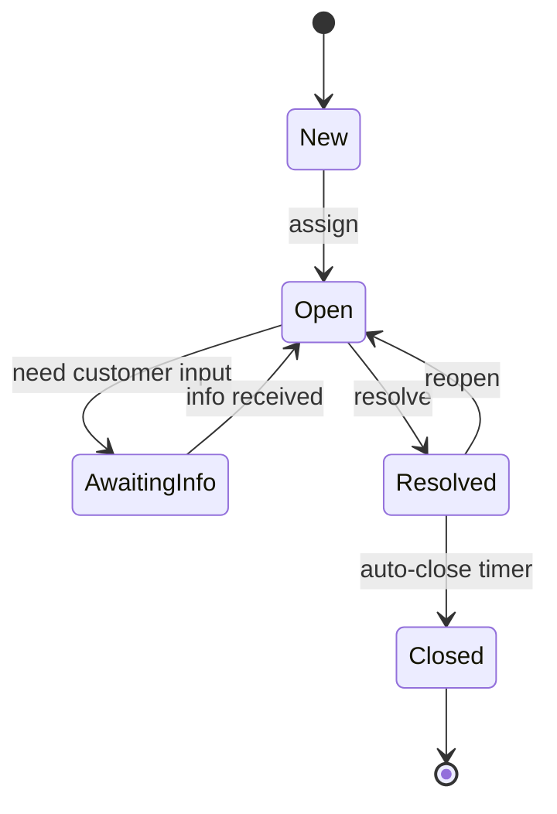
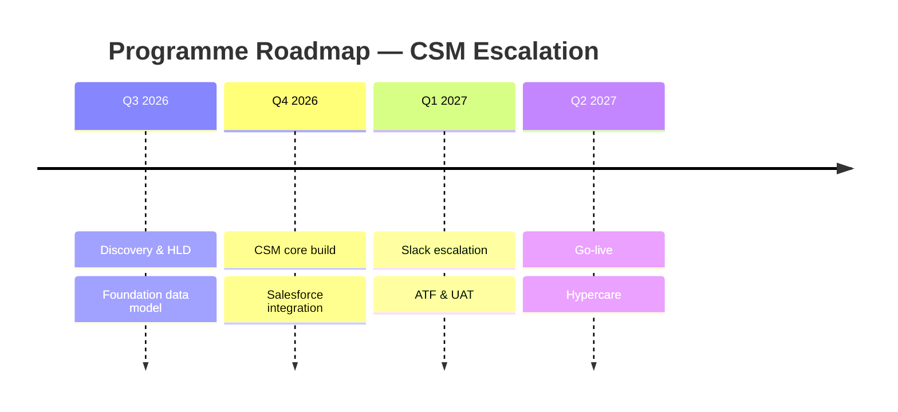
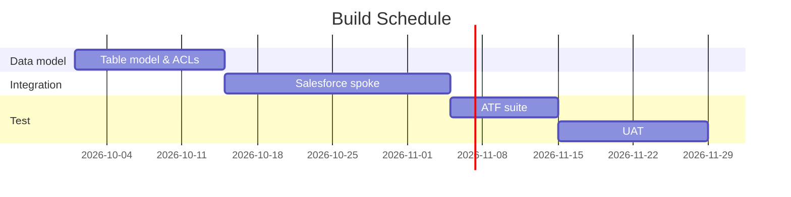
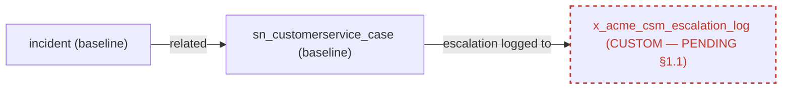

# Diagramming Specialist — EXAMPLES

Gold-standard reference. Every example applies the discipline from `SKILL.md`: a legend, exact spec identifiers, one message per figure, fidelity notes, and §1.1 flags. The figures below are sketched in Mermaid so the examples stay readable as text; every delivered figure is an editable `.drawio` in the house style (Example 6), and all Mermaid blocks are written to parse.

---

## Example 1 — Skill mode: one sequence diagram (integration round-trip)

**Source spec:** Integration Specialist spec "P1/P2 incident → Azure DevOps work item on resolve". **Format:** draw.io (`.drawio`) + SVG export; the figure below is its Mermaid draft.

### Legend
Actors = participants; ServiceNow components prefixed `SN`; external system on the right; `Note` blocks carry non-happy-path behaviour.

### Figure 1 — Resolve-to-ADO outbound call (happy path + failure handling)
```mermaid
sequenceDiagram
    autonumber
    actor A as Agent (itil)
    participant SN as ServiceNow (incident)
    participant FL as Flow Designer
    participant SP as ADO Spoke (IntegrationHub)
    participant ADO as Azure DevOps (REST / OAuth2)
    A->>SN: Resolve incident (state → 6 Resolved)
    SN->>FL: Trigger — incident.state=6 AND priority IN (1,2)
    FL->>SP: Create Work Item action
    SP->>ADO: POST /_apis/wit/workitems (OAuth2)
    ADO-->>SP: 201 Created (id)
    SP-->>FL: work_item_id
    FL->>SN: Set incident.correlation_id = work_item_id
    Note over SP,ADO: Retry 3x exponential backoff;<br/>exhausted → DLQ record + work note on incident
```

### Fidelity notes
- `incident`, `state=6 (Resolved)`, `priority IN (1,2)` — taken verbatim from the spec's trigger condition.
- `correlation_id` is the baseline field the spec writes the work item id to.
- ADO endpoint path is illustrative; the spec owns the exact route.

### §1.1 flags
None new — the DLQ record lands in `x_acme_itsm_ado_dlq`, which the spec's envelope pre-approved, so it is drawn as approved, not PENDING.

### Export notes
The Mermaid above is the draft. The delivered figure is a house-style `.drawio` (Example 6), rendered to SVG by `scripts/render-drawio.sh` for the client pack.

---

## Example 2 — Sub-agent mode: a 3-figure diagram pack for an HLD

**Source spec:** Technical Designer spec + CSM gateway Constraint Envelope, "Customer escalation capability". **Format:** draw.io (`.drawio`) + SVG export; the figures below are Mermaid drafts. One legend governs all figures.

### Legend
Platform systems = `System`; external = `System_Ext`; baseline tables solid; references shown with cardinality; lifecycle states are nodes.

### Figure 1 — System context (C4 L1) — *who and what talks to the platform*


### Figure 2 — Data model (ERD) — *the records and their relationships*


### Figure 3 — Case lifecycle (state) — *the one message: how a case moves*


### Fidelity notes
- All table names (`sn_customerservice_case`, `customer_account`, `customer_contact`, `sn_customerservice_task`, `sn_customerservice_escalation`) come from the Envelope's Data Model Alignment — all baseline *(citation: `markdown/customer-service-management/case-escalation-components.md`)*.
- Escalation is a record of its own [`sn_customerservice_escalation`], whose states are Requested, Escalated, Declined and, once de-escalated, Closed; the case lifecycle in Figure 3 carries no escalation state, matching the spec *(citations: `markdown/customer-service-management/case-escalation-form.md`, `markdown/customer-service-management/de-escalate-csm-case.md`)*.

### §1.1 flags
None — every object is baseline-confirmed in the Constraint Envelope.

### Export notes
Three figures, one legend. For the review board deck, deliver each as a `.drawio` and render the folder to SVG with `scripts/render-drawio.sh`; keep the `.drawio` sources in the HLD's Diagram Sources appendix.

---

## Example 3 — Project visuals (the "and so on": roadmap, schedule, RACI)

**Source spec:** programme plan in the HLD. **Format:** draw.io (`.drawio`) + SVG export, plus a RACI table; the figures below are Mermaid drafts.

### Figure 1 — Roadmap (timeline)


### Figure 2 — Build schedule (Gantt with dependencies)


### Figure 3 — RACI (rendered as a table, not a graph)
| Activity | Architect | Developer | CSM Lead | Ops |
|---|---|---|---|---|
| Table model & ACLs | A/R | C | C | I |
| Salesforce integration | A | R | C | I |
| UAT sign-off | C | I | A/R | C |
| Go-live & hypercare | A | R | C | R |

*R = Responsible, A = Accountable, C = Consulted, I = Informed.*

### Fidelity notes
Phases, durations, and ownership are lifted from the programme plan; no dates invented — where the plan was silent (e.g. hypercare length) it's marked open below.

### Open questions
- Hypercare duration not stated in the plan — assumed within Q2 2027; confirm.

---

## Example 4 — §1.1 flag: the spec contains an unapproved custom table

**Source spec:** a draft design that introduces `x_acme_csm_escalation_log` with **no approval trail**. The Diagramming Specialist still draws it — but renders it PENDING, never as accepted.

### Legend
Baseline = solid; **custom-pending = dashed red border**.

### Figure 1 — Escalation logging (custom object flagged)


### §1.1 flags
- **`x_acme_csm_escalation_log`** — custom table, **no approval in the source spec**. Rendered dashed/PENDING. This is **not mine to bless**: the orchestrator must run the §1.1 ruling (baseline option evaluated — could `sys_journal_field`/work notes or the audit history cover this? — custom proposed at smallest scope, consequences, alternatives) before any builder treats it as accepted. Until then the diagram shows it pending and this flag stands.

### Fidelity notes
The table is drawn because the *spec* contains it; the dashed style and PENDING note encode that it lacks approval. Removing it would misrepresent the spec; drawing it solid would launder the violation — so it is shown, but flagged.

---

## Example 5 — Export to SVG and embed into an HLD

Takes the Figure-2 ERD from Example 2, built as a house-style `.drawio` (Example 6), and embeds its SVG export in the HLD.

**1. Save the source** — `clients/acme/csm-escalation-hld/diagrams/fig-02-data-model.drawio`, hand-built in the house style (Example 6); the `erDiagram` block in Example 2 is only its draft.

**2. Render locally with the house script** (no external service), from the checkout root:
```
scripts/render-drawio.sh clients/acme/csm-escalation-hld/diagrams svg
```
→ writes `fig-02-data-model.svg` beside the source and prints `done: 1 rendered, 0 failed  (clients/acme/csm-escalation-hld/diagrams)`. That file is the export, never hand-authored. Run it again with `png` when the HLD goes to Word: `scripts/md-to-docx.py` embeds PNG only.

**3. Embed into the HLD section** — place the exported image with its numbered caption:
```

```

**4. Diagram Sources appendix** (keeps every figure editable):

| Figure | Source (`.drawio`) | Export (`.svg`) |
|---|---|---|
| Figure 2 — Data model (ERD) | `diagrams/fig-02-data-model.drawio` | `diagrams/fig-02-data-model.svg` |

The `.drawio` is the source of truth; the `.svg` is its export. After any edit, re-run step 2 to re-export.

---

## Example 6 — house style as draw.io (`.drawio`) — copy-paste mxCell styles

Every delivered figure is an editable `.drawio` styled to the house palette. Reuse these mxCell `style=` strings; the SVG/PNG you embed in a doc is the output of `scripts/render-drawio.sh` from the result, never hand-authored.

| Element | mxCell `style=` |
|---|---|
| ServiceNow / baseline | `rounded=1;html=1;fillColor=#eafaf1;gradientColor=#d6f0e1;strokeColor=#18a558;fontColor=#0a5c38;shadow=1;arcSize=12;` |
| Actor / role | `…;fillColor=#eef1ff;gradientColor=#e0e4fd;strokeColor=#6366f1;fontColor=#3730a3;` |
| External system | `…;fillColor=#f7f8fa;gradientColor=#eceef1;strokeColor=#94a3b8;fontColor=#334155;` |
| Custom field (config) | `…;fillColor=#fff7ea;gradientColor=#fdeccf;strokeColor=#f59e0b;fontColor=#92400e;` |
| **Custom — PENDING §1.1 / manual** | add `dashed=1;dashPattern=7 5;` (red `#dc2626` / amber `#f59e0b`) |
| Group / module | `swimlane;rounded=1;startSize=32;fillColor=#eafaf1;swimlaneFillColor=#fbfcfe;strokeColor=#cbd5e1;fontColor=#0a5c38;fontStyle=1;` |
| Edge / arrow | `endArrow=block;strokeColor=#94a3b8;strokeWidth=2;` |

Minimal `.drawio` skeleton (a baseline node → a PENDING node):

```xml
<mxfile><diagram name="fig"><mxGraphModel><root>
  <mxCell id="0"/><mxCell id="1" parent="0"/>
  <mxCell id="n1" value="incident" style="rounded=1;html=1;fillColor=#eafaf1;gradientColor=#d6f0e1;strokeColor=#18a558;fontColor=#0a5c38;shadow=1;arcSize=12;" vertex="1" parent="1"><mxGeometry x="40" y="40" width="160" height="56" as="geometry"/></mxCell>
  <mxCell id="n2" value="x_acme_custom (PENDING §1.1)" style="rounded=1;html=1;fillColor=#fff5f5;gradientColor=#fde4e4;strokeColor=#dc2626;fontColor=#b91c1c;dashed=1;dashPattern=7 5;arcSize=12;" vertex="1" parent="1"><mxGeometry x="260" y="40" width="220" height="56" as="geometry"/></mxCell>
  <mxCell id="e1" style="endArrow=block;strokeColor=#94a3b8;strokeWidth=2;" edge="1" parent="1" source="n1" target="n2"><mxGeometry relative="1" as="geometry"/></mxCell>
</root></mxGraphModel></diagram></mxfile>
```

Full reference: `.claude/skills/diagramming-specialist/templates/house-style-reference.drawio` (open in draw.io / VS Code / Lucidchart). **Hand-craft every delivered figure to this standard** — labels exact-to-spec, the shared palette, one shared legend; render the SVG/PNG for the doc with `scripts/render-drawio.sh`; never ship a recolored Mermaid as the figure.

---

*End of Diagramming Specialist EXAMPLES.md v1.0.*
