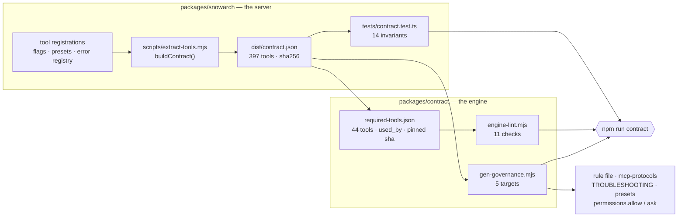

# ARCHITECTURE.md — target repository layout

> **Stub.** ARC-01-S01 writes this file so that reviewers of ARC-01-S02…S12 have the target in front of
> them while files are being moved into it. **ARC-01-S12 replaces it** with the full architecture
> document. The tree below is `docs/plans/01-TARGET-ARCHITECTURE.md` §3 **verbatim** — that document
> remains the source of truth; this is a convenience copy, and if the two ever disagree, `01` wins.

## The target tree

```
snowarch/                                     farstic/snowarch · one git tag per release
├── CLAUDE.md                                 ≤200 lines: identity, routing protocol (Phase 1/2), §1.1 summary, the `Status` trigger (→ `/snowarch status`); imports nothing large
├── README.md                                 the ONE install page (2 commands, 2 dialogs, what you will see)
├── LICENSE · NOTICE                          single licence (BUSL-1.1 from 2.1.0, ADR-0011; Apache-2.0 before, D-02); Apache-2.0 attribution for ServiceNow/ServiceNowDocs
├── engine.config.json                        product name, server key, floors (claude/node/git), docs family+pin, roster expectations
├── package.json · package-lock.json          ROOT = version of record; workspaces ["packages/*", "tools/snowarch"]; scripts {bootstrap, doctor, test, lint, release}
├── bootstrap.sh · bootstrap.ps1 · bootstrap.cmd   launchers (bash 3.2 / PowerShell 5.1 / cmd → PowerShell with -ExecutionPolicy Bypass)
├── snowarch · snowarch.cmd                   post-install command launcher → node tools/snowarch/bin/snowarch.mjs "$@"
├── .mcp.json                                 COMMITTED, secret-free project-scope registration of server key "servicenow" (§5)
├── .gitmodules                               vendor/ServiceNowDocs · branch = australia · shallow = true
├── .gitignore                                .local/ clients/ node_modules/ .env .claude/settings.local.json .DS_Store Thumbs.db
├── .gitattributes                            *.mjs *.md *.json *.sh text eol=lf; *.ps1 *.cmd eol=crlf
├── .claude/
│   ├── settings.json                         COMMITTED team settings: env.MCP_TIMEOUT, SessionStart hook (exec form, node), generated permission allow-list (reads) and ask-list (mutating tools — the mechanical half of §2.1 under auto mode)
│   ├── rules/
│   │   └── 00-mode-and-mcp-gate.md           GENERATED from the contract: the §2.1 write gate (prefix, "write approved"), §2.2 capture sequence, Mode semantics (~40 lines, always loaded)
│   ├── skills/
│   │   ├── <28 specialist skills>/SKILL.md + EXAMPLES.md   single canonical copy; descriptions ≤ 500 chars (lint); triggers in body
│   │   ├── now-assist-genai/                 reference companion (28th SKILL.md)
│   │   └── snowarch/SKILL.md                 /snowarch status · setup-instance · doctor (R-2): quotes the doctor Mode line; guided front-end of the wizard (§6); roster from directory listing
│   └── agents/<9>.md                         single canonical copy; model: inherit; skills: [<persona>] preload; explicit tools lists (no MCP)
├── governance/
│   ├── governance/governance-rules.md                   §1.1, §2 (references the generated rule), §4 — read on demand as today
│   ├── governance/taxonomy.md · governance/prompt-patterns.md      read on demand as today
│   └── mcp-protocols.md                      GENERATED long form of §2.1/§2.2 with current tool names (the rule file is its digest)
├── packages/
│   ├── snowarch/                             the server + CLI package (from farstic/snow-mcp, server-only scope — ARC-04)
│   │   ├── package.json                      name @farstic/snowarch; version == root (lint); engines node>=20; runtime deps only
│   │   ├── src/                              server.ts, tools/, servicenow/, utils/, resources/, cli/ (instance · doctor · contract · start)
│   │   ├── dist/                             COMMITTED prebuilt output incl. tools-manifest.json and contract.json (CI rebuilds and diffs)
│   │   └── tests/                            vitest (server-scoped root), incl. contract.test.ts
│   └── contract/
│       ├── required-tools.json               41 tools = 35 engine-cited + snow_us_update_set_preview (§2.2 protocol) + 5 core, each {name, gate, mutates, used_by[]}; contractSha256 pin
│       ├── retired-names.json                copy of tool-rename-map.json keys — forbidden as bare words
│       └── lint/engine-lint.mjs              engine-side contract lint (§11)
├── tools/snowarch/                           ZERO-DEPENDENCY Node ESM CLI (node:fs, child_process, readline, https, crypto)
│   ├── bin/snowarch.mjs                      bootstrap | doctor | instance … | docs … | mode … | upgrade | version
│   ├── lib/steps/B00…B09.mjs                 one file per bootstrap step (idempotent; declares an inputs hash)
│   ├── lib/steps/index.mjs                   the registry and the runner: order, cache decision, interrupt
│   ├── lib/plan.mjs                          the one amendable plan screen (principle 10)
│   ├── lib/state.mjs                         .local/bootstrap-state.json read/write/resume
│   ├── lib/doctor/                           engine-side checks E-xx; merges server checks SV-xx from packages/snowarch
│   └── hooks/session-start.mjs               prints the Mode banner (<300 ms; reads .local/doctor-last.json)
├── vendor/
│   ├── ServiceNowDocs/                       submodule, checked out depth-1 + cone-sparse (§10)
│   └── docs-areas.txt                        GENERATED list of cited top-level areas (one per line; consumed by launchers and Node)
├── templates/                                ADR, RTM, RAID, NFR, HLD, Gherkin (merged)
├── docs/
│   ├── INSTALL.md (= README body) · MODES-AND-PRESETS.md · TROUBLESHOOTING.md (GENERATED) · PLATFORM-NOTES.md · ARCHITECTURE.md · CONTRIBUTING.md · CHANGELOG.md (GENERATED) · MIGRATION.md (ARC-10) · USER-GUIDE.md · CLIENT-ONBOARDING.md (ARC-02)
├── scripts/                                  MAINTAINER only: build-dist.mjs, release.mjs, gen-docs-areas.mjs, docs-bump.mjs, md-to-docx.py/.ps1, render-drawio.sh / render-diagrams.ps1, render-pdf.sh / render-pdf-pages.ps1
├── tests/                                    engine tests: roster lint, description-length lint, version-consistency, VALIDATION-TESTS.md (manual T-01…T-18)
├── .github/workflows/ci.yml · docs-bump.yml · release.yml
└── .local/                                   GITIGNORED per-checkout state: instances.json (0600) · config.json · bootstrap-state.json · doctor-last.json · audit.jsonl · logs/
```

Not in the repository: any client engagement content (`clients/` stays gitignored and per checkout), `.claude/settings.local.json`, `.env`, the author's personal hook tooling (see the retired-name glossary below), the Electron desktop app, the other-client guides.

## Directory → owner ARC

Which programme increment first creates or populates each path. **Nothing is created empty**: git tracks
no empty directories, so a path appears in the repository only when its owner puts a file in it.

| Path | Owner | Notes |
|---|---|---|
| `LICENSE` · `NOTICE` · `docs/RELICENSING.md` | **ARC-01** (S01) | D-02; the relicensing sentence is in this commit's message |
| `docs/decisions/` | **ARC-01** (S01) | ADR-0001…0008, imported verbatim from the spike workspace |
| `docs/spikes/` | **ARC-01** (S01) | ARC-00's spike records, stub server, recipes, hooks, licence working files |
| `engine.config.json` | **ARC-01** (S01) | from `spikes/engine.config.seed.json`; schema validated by ARC-01-S04 |
| `docs/ARCHITECTURE.md` | **ARC-01** (S01 stub → **S12** full) | this file |
| `CLAUDE.md` · `governance/` · `.claude/skills/` · `.claude/agents/` · `templates/` · `scripts/` | **ARC-02** | engine consolidation; imported with history |
| `README.md` · `.gitignore` · `.gitattributes` | **ARC-01** (S02 import, S07 replace) | the engine's own files arrive first, then are replaced |
| `vendor/ServiceNowDocs` · `vendor/docs-areas.txt` · `.gitmodules` | **ARC-03** | docs corpus; recipe C **plus the root-file repair step** (ADR-0008) |
| `packages/snowarch/` | **ARC-04** | the MCP server and its CLI |
| `packages/contract/` | **ARC-05** | required-tools, retired-names, engine-lint |
| `.claude/settings.json` · `.claude/rules/` | **ARC-05** | generated permission rules and the §2.1/§2.2 rule file |
| `bootstrap.sh` · `bootstrap.ps1` · `bootstrap.cmd` · `snowarch` · `snowarch.cmd` · `.mcp.json` · `tools/snowarch/` | **ARC-06** | bootstrap and registration |
| `tools/snowarch/lib/steps/` (instance wizard) | **ARC-07** | credentials; `.local/instances.json` at 0600 (D-04) |
| `tools/snowarch/lib/doctor/` · `tools/snowarch/hooks/` | **ARC-08** | doctor and self-heal |
| `.github/workflows/` · `package.json` · `package-lock.json` | **ARC-01** (S11) → **ARC-09** | CI first, then release and upgrade |
| `docs/MIGRATION.md` | **ARC-10** | migration and cutover |
| `.local/` · `clients/` | — | **gitignored, per checkout**; never committed |

## Product constants

`engine.config.json` is the one place a product constant is written down, and this is what each key
is for. Every leaf key has a row and every row names a key that exists —
`tests/version-consistency.test.mjs` asserts both directions, so a key added without a row, or a row
left behind by a key that went, is a failing test rather than a thing somebody notices later.

Values are not repeated here: the file is the source, and a copy of a value in prose is a second
source that drifts. The schema beside it (`engine.config.schema.json`) refuses an unknown key.

| Key | What it is | Who reads it |
|---|---|---|
| `product` | the product's short name, used where a human-readable identifier is needed | the doctor's header, the banner, generated docs |
| `repo` | `<owner>/<name>` on GitHub | the release script, the upgrade check's remote, the install page |
| `cli` | the launcher's name, the thing a user types | `bootstrap.sh` / `bootstrap.cmd`, the recipe, the install page |
| `mcp.serverKey` | the key the server is registered under in `.mcp.json` and `claude mcp` | registration, the doctor's E-23/E-24, the `/mcp` panel a user sees |
| `mcp.package` | the npm package name the server publishes as | the publish guard (D-01), `version`, the tarball checks |
| `mcp.packageDir` | where the server package lives in this repository | the contract gate, the build, the doctor's SV- checks |
| `mcp.permissions.allowStyle` | how `permissions.allow` entries are written — `explicit` rather than a glob | the registration writer, ARC-05-S07's generator |
| `mcp.permissions.askStyle` | how an `ask` rule is spelled | the same writer, and the S-18 spike's answer |
| `floors.claudeCode` | the oldest Claude Code the product supports | the doctor's E-00, the bootstrap preflight, the S-11 verdict |
| `floors.node` | the oldest Node the product supports | the same three, and the `engines` field the package publishes |
| `floors.git` | the oldest git the product supports | the bootstrap preflight and the B00 remedy |
| `docs.family` | the ServiceNow release family the corpus is checked out at | `docs sync`, `docs family`, every citation check |
| `docs.pin` | the corpus commit the repository records | `docs sync`, the doctor's E-12…E-14, the docs-bump workflow |
| `docs.areasFile` | where the sparse-checkout area list lives | `docs sync`, `gen-docs-areas.mjs --check` |
| `docs.upstream` | the corpus repository to clone from — there is no environment override | `docs sync`, the failure classifier's remedy text |
| `roster.skills` | how many skills the roster has | `gen-roster.mjs --check`, the doctor's E-20 |
| `roster.agents` | how many agents the roster has | the same two |
| `roster.utility` | the utility skills, which are not personas and are counted separately | `gen-roster.mjs`, the roster lint |
| `licence.revocations.repo` | where the signed revocation list is published, fetched by git from this address and never from `origin` (ARC-11-C1) | `licence check --refresh`, `upgrade` and `upgrade --check` with a licence installed, and a live server start |
| `licence.revocations.ref` | the branch that carries the list | the same three |
| `licence.revocations.path` | the list's file on that branch | the same three |

## Registration files

Two files travel with the clone and one never does.

**`.mcp.json`** registers the server: `stdio`, `node`, and
`${CLAUDE_PROJECT_DIR:-.}/packages/snowarch/dist/server.js` — forward slashes, because Node accepts
them on Windows and a backslash in JSON is an escape waiting to be got wrong. Every `${…}` carries a
`:-` default, since an unset variable without one is passed through as the literal text. The `env`
block holds `SNOW_STORE` and `SNOW_LOG_LEVEL` and nothing else: ARC-00 S-20 confirmed the spawned
server **inherits** the launching shell's environment, so proxy and CA variables need no repeating
(the story's other branch, listing them, belongs to the "forward" verdict we did not get).

**`.claude/settings.json`** holds `permissions` — **generated** from the contract by
`gen-governance.mjs`, never hand-written — and `env.MCP_TIMEOUT: "120000"`, which is ARC-00 S-06's
measurement: about 160× the worst handshake observed over 27 runs on nine CI cells. It is
**hook-free** by ARC-00 S-05: a `SessionStart` hook in the committed file would run before Node is
known to exist, so the bootstrap writes it into the gitignored `settings.local.json` once Node ≥ 20
is confirmed.

**`~/.claude.json` is never written by anything here.** That file is why P-01 exists — the previous
engine was registered by hand-editing it and ended up holding a plaintext password keyed on an
absolute path. Measured on this checkout: starting a session changes exactly one top-level key,
`cachedGrowthBookFeaturesAt`, the CLI's own feature-flag cache.

## Docs corpus: how the pin, the areas file and the gate relate

Four artefacts, and the design is which of them may disagree with which.

| Artefact | Written by | Read by |
|---|---|---|
| **the commit** — the gitlink and `docs.pin`, the same SHA | the seed commit, then only `docs sync --upstream` — never by hand | the recipe, the launchers, the doctor's E-checks, `docs-bump.yml`, ARC-09's release tag |
| **`vendor/docs-areas.txt`** — which areas materialise | `gen-docs-areas.mjs`, from the areas cited; CI fails when stale | the cone, the completeness check, the recipe |
| **the citation gate** — every `markdown/…` path cited | nobody: a property of the skills | `docs verify`, `docs status`, the bump workflow, CI |
| **the identifier check** — every ServiceNow name the roster writes | nobody: a property of the skills, with `identifier-allowlist.json` for the examples' own names | `docs verify`, CI |

**The invariants**, in the order they are checked:

- `docs.pin` **==** the gitlink. They diverge only while a bump is staged; `docs status` prints
  `(staged)` for exactly that window instead of MISMATCH.
- the cone **==** the areas file **plus `legal/`**. `legal/` is neither an area nor a root file, so
  cone mode leaves it out — the recipe names it and the completeness check enforces it, because
  NOTICE claims it is in every checkout and a claim nothing checks is a claim that decays.
- **dead citations == 0.** A citation upstream removed is the corpus saying a skill is now wrong about
  the platform. Never fixed by deleting the citation.
- **an absent corpus is a FAIL, never a skip** — the script this replaced exited 0 with the corpus
  missing, so a fresh clone passed with every citation unverified.

### The commands

`docs sync` reconciles locally and is safe for anyone: clone if absent, mode, pin, gitlink, the
ADR-0008 root repair. A clean second run issues no git write, prints `up to date`, and ends — as
every run does — with the attribution line. **Populated is checked separately from at-the-pin**: a
`--no-checkout` clone whose pin is the branch tip has correct HEAD and an empty tree. `docs status` answers "is this corpus right" in four
lines (pin/gitlink/HEAD · family/branch · shape and areas · citations), each `ok` or `MISMATCH` with
its remedy, computed by `docsStatus()` — which ARC-08's doctor wraps rather than re-derives.

`docs sync --upstream` is the maintainer refresh: refuse a dirty tree, fetch, **verify at the old
pin**, move, verify again, write the pin, stage — never commit. The baseline runs first because
"newly dead" is a difference between two states, and the first stops existing when the corpus moves.

`docs family <name>` switches release family: the dry run **is** the proposal and `--yes` applies
exactly what it printed. A prose line is edited only when the matched phrase is its *only* family
mention — anything else is REVIEW, because half a sentence about each family is worse than an
untouched line. The pin moves first, while the tree is still clean, so the dirty-tree refusal guards
the whole operation instead of tripping on the command's own edits.

`docs-bump.yml` runs the refresh weekly and opens **one** pull request — branch named for the
target SHA, so a re-run updates rather than duplicates and a newer tip supersedes the older. **It
never merges.** A dry run exits 0 with a `::warning::`; the red build belongs on the pull request. It
builds from the PR's **base**, not the dispatch ref, and needs two repository settings it cannot
assert: "Allow GitHub Actions to create and approve pull requests", and "Approve and run" on a
bot-authored PR's first CI run.

`docs-real.yml` runs the recipe against the **real** corpus on all three OSes — weekly, on demand,
and when the code that decides the checkout changes; not a required context (network, a minute per
OS). Its Windows cell strips Git Bash and clears `core.longpaths` first so it measures the recipe
rather than the image, and a second cell keeps Git Bash: the two passing identically is the proof
nothing here depends on bash.

**E-12** is `E12_ABSENT(mode)` in `status.mjs`, printed by `docs status` and imported by the doctor,
never retyped — **FAIL**, never WARN or SKIP, because an absent corpus leaves every citation in every
skill unverified.

### The git-only corpus recipe

ARC-06's launchers run this when Node is absent. Not a paraphrase of `sync.mjs`: the **commands**
are the **POSIX form** of `--print-recipe`'s, for a tree with no checkout, in that order and
character for character. POSIX form because `--print-recipe` renders for the platform the operator
is on, and the Windows one carries `-c core.longpaths=true` on every command plus a persistent
`config` line; this block is the POSIX sequence and a Windows-only step appearing in it is a defect
the test names. What
the block adds, and all it adds, is the packaging the generator renders — the ` && \` that stops the
chain at the first failure, the clone's `[ -e … ]` precondition, `{ … || true ; }` on the two
tolerated `submodule` steps, and the re-run note as the last line. `--print-recipe` stays unpackaged
because the shell it is being pasted into is unknown on Windows. `tests/docs-recipe.test.mjs`
asserts that relation in both directions: every command the CLI prints appears in the block, in
order, and the block adds nothing but those four things. Edit the module, regenerate, paste — never
the reverse. The area list is one long line on purpose; wrapped or reordered is a different
checkout.

<!-- DOCS-RECIPE:BEGIN (generated by scripts/gen-docs-recipe.mjs — do not edit) -->

```sh
{ [ -e vendor/ServiceNowDocs/.git ] || git clone --filter=blob:none --no-checkout --depth 1 --sparse --branch australia https://github.com/ServiceNow/ServiceNowDocs.git vendor/ServiceNowDocs ; } && \
git -C vendor/ServiceNowDocs sparse-checkout set --cone markdown/api-reference markdown/application-development markdown/build-workflows markdown/core-business-suite markdown/customer-service-management markdown/employee-service-management markdown/financial-services-operations markdown/governance-risk-compliance markdown/integrate-applications markdown/intelligent-experiences markdown/it-asset-management markdown/it-business-management markdown/it-operations-management markdown/it-service-management markdown/now-intelligence markdown/now-platform markdown/platform-administration markdown/platform-security markdown/platform-user-interface markdown/servicenow-platform legal && \
git -C vendor/ServiceNowDocs fetch --depth 1 origin aa447ce4ea802c880af9dd365a114d3e6eb1cc19 && \
git -C vendor/ServiceNowDocs checkout --detach aa447ce4ea802c880af9dd365a114d3e6eb1cc19 && \
{ git submodule absorbgitdirs vendor/ServiceNowDocs || true ; } && \
{ git submodule init -- vendor/ServiceNowDocs || true ; } && \
echo "docs: ServiceNow product documentation © 2026 ServiceNow, Apache-2.0 — vendor/ServiceNowDocs/LICENSE"
# if a step fails with a network error, re-run: a failed run leaves nothing behind, and a re-run of a checkout fetches only what is missing
```

<!-- DOCS-RECIPE:END -->

**On Windows the sequence gains one line** — a single block cannot be byte-identical on both
platforms, so this one is the POSIX form:

```powershell
git -C vendor/ServiceNowDocs config core.longpaths true
```

The launcher then checks each line of `vendor/docs-areas.txt` exists under
`vendor/ServiceNowDocs/markdown/` and prints `citations: not verified until Node 20+ is installed`.
S-07's criterion 2 was left unanswered, not refuted — the record's words are "the `core.longpaths`
control did NOT reach MAX_PATH, so AC 2 is unanswered for a real install path", and the corpus fits
in 260 characters under a *short* prefix. A CI temp directory ate that margin at ARC-03-S05 and
again at ARC-09-C27 (~285 characters, one Windows cell red), so `core.longpaths` stays.


## Exit codes — every `docs` sub-command shares one table

| Code | Meaning |
|---|---|
| **0** | ok |
| **1** | incomplete checkout · the pin moved **and** citations broke · dead citations · a status mismatch |
| **2** | a plan was printed and not applied (`family` without `--yes`) |
| **3** | the corpus is missing |
| **4** | the working tree is not clean — nothing was touched |
| **5** | git failed; the message says how (DNS · proxy · TLS · unfetchable pin · disk) |
| **6** | the upstream does not have what was asked for — renamed branch, unreachable SHA |

4, 5 and 6 stay distinct: "you have unsaved work", "the transport failed" and "it is not there" have
three different remedies, and a caller that collapsed them would send someone to the wrong one.

## Bootstrap steps and state file

`./snowarch bootstrap` shows one amendable plan, then runs ten numbered steps uninterrupted,
recording each one so a failure, a Ctrl-C or an upgrade never means starting over.

### The steps

Each step module in `tools/snowarch/lib/steps/` — `B00.mjs` through `B09.mjs` — exports
`{ id, title, needsNode, runsWhen, inputs, run }`
and, when it can be skipped, a `skipReason`. Every module is importable and its `run(ctx)` callable
on its own, so ARC-08's `--fix` can invoke one without the runner.

| Step | Title | Needs Node | Runs when | Inputs hashed |
|---|---|---|---|---|
| B00 | preflight | no | always (never cached) | — |
| B01 | workspace | no | always | `.mcp.json`, `.claude/settings.json`, mode |
| B02 | docs | no (checkout) / yes (citations) | docs mode ≠ skip | the areas file, the corpus gitlink from the index, docs mode |
| B03 | mode | no | always | the accepted mode |
| B04 | deps | yes | mode = live | `package-lock.json`, Node **major** |
| B05 | contract | yes | Node present | `dist/contract.json`, `required-tools.json` |
| B06 | instance | yes | mode = live **or** a store exists | store schema version, store presence, whether `--instance-file` was given |
| B07 | toggles | no | always | mode, Node present, the hook branch, registration kind |
| B08 | verify | yes | mode = live | contract sha, store mtime |
| B09 | summary | no | always (never cached) | — |

B00 and B09 are never cached, and each says so on the step rather than in the runner: B00 decides
whether the machine can run the others, and B09 describes the run that just happened.

### The hash, and what it is allowed to read

Every input is TAGGED — `file:<path>` or `text:<value>` — and `sha256` runs over the tag, the key
and the content of each, NUL-separated, in the order the step declared them. A missing file hashes
as the literal `<absent>`, so "not installed yet" and "installed nothing" are different digests. An
untagged entry is an error rather than a guess: read as a path, `design-only` would be found missing
and hashed as `<absent>`, which would give live and design-only the same digest.

Two inputs are deliberately narrow. B02 hashes the **gitlink**, not the corpus — reading 35,000
files to decide whether to skip a step would cost more than the step, and an unrelated `touch` would
invalidate it. B06 hashes only the store's schema version and whether it exists: `.local/instances.json`
holds credentials, and a hash that read further would put one a careless line away from the log.

### B00 preflight — the seven checks

Every prerequisite is checked before anything is installed, and **every check runs even after one
has failed**: an operator missing git *and* behind a TLS-intercepting proxy learns both in one pass
rather than discovering the second after fixing the first. Any FAIL ends the run with
`FAIL B00: <n> prerequisite(s) missing` and **exit 3** — before the plan screen, and before
`.local/` exists.

| # | Check | Fails when | Remedy comes from |
|---|---|---|---|
| 1 | root | `cwd` is not the checkout, or git reports a different toplevel (both compared through `realpath`) | `remedies.json` → the platform's own `cd` |
| 2 | git | absent, or below `floors.git` | `xcode-select` · `winget` · the distribution package |
| 3 | Claude Code | absent, or below `floors.claudeCode`. Not logged in is a **WARN**, never a FAIL — signing in is Claude Code's own first-run flow | the install page |
| 4 | disk | less than 1 GiB free (1.5 GiB for the full corpus). Unmeasurable is a WARN, not a FAIL | `free up <n> MB on <mount>` |
| 5 | network | `HEAD https://github.com/` fails — through `HTTPS_PROXY` by CONNECT tunnel, honouring `NO_PROXY` | the shared network vocabulary (below) |
| 6 | Node | absent or below `floors.node` — a `note:` in design-only, a FAIL only for live | `brew` · `winget` · nvm |
| 7 | platform | never; 32-bit is a WARN | — |

The floors are read from `engine.config.json` and **never typed into the code**; a test strips
comments from every module under `tools/snowarch/lib/` and asserts none of them spells a configured
floor, so lowering a floor in the config genuinely lowers the threshold.

Remedies live in `tools/snowarch/lib/remedies.json` as `{ checkId: { darwin, win32, linux, default } }`
because the Node-free launchers (S10/S11) print the same sentences with no Node to read them, and
the doctor quotes the same table. One wording, three programs.

**One network vocabulary.** `lib/net-sentences.mjs` owns the DNS, proxy, TLS and disk sentences;
`classifyGitFailure` (git's stderr) and `probe-net.mjs` (Node's HTTPS) both import them, so an
operator behind a corporate proxy does not learn two vocabularies for one problem depending on which
half of the tool noticed first. The single parameterised difference is the CA sentence: it names the
failing tool's knob first (`GIT_SSL_CAINFO` or `NODE_EXTRA_CA_CERTS`) and the other second, because
a corporate bundle is always needed by both. A proxy URL is masked to `***@host:port` where the
sentence is built, not on the way to the terminal.

### B01 workspace and B07 Claude settings — what the bootstrap writes

Four files, all of them gitignored, and **nothing outside the checkout**: `~/.claude.json` and
`~/.claude/settings.json` are never touched.

| File | Written by | What goes in it |
|---|---|---|
| `.local/` (+ `logs/`) | B01 | 0700 on POSIX — an existing directory is chmodded, so a checkout bootstrapped before this rule stays private too. Windows records `fileModes: acl-inherited`. |
| `.local/bootstrap-state.json` | the runner | S03's schema v1 |
| `.claude/settings.local.json` | B07 | **two array members and one hook entry, merged** |
| `.local/config.json` | B07 | `{ version, mode, defaultInstance, registration, updatedAt }` |

**`settings.local.json` is never overwritten.** It belongs to the operator — their permission
grants, their overrides, whatever Claude Code has written on their behalf. B07 reads it, applies its
two changes and writes the same object back: other keys untouched, other array members preserved,
existing key order kept, new keys appended. Design-only puts the server in `disabledMcpjsonServers`
(which wins over the enable list in Claude Code); live puts it in `enabledMcpjsonServers` and
removes the disable entry. A registration that is not `project` rejects the project entry whatever
the mode says. **Invalid JSON is the only failure**, and the bytes are left exactly as found — a
stray comma must not cost someone their settings. The file must be gitignored before anything is
written, or Claude Code will not apply its approvals.

**The SessionStart hook is S-05 variant B**: the committed `settings.json` is hook-free, and B07
writes the hook into the *local* file only when Node ≥ 20 is present, removing it otherwise. A hook
that runs `node` on a machine without Node is an error on every session start. There is no
`disableAllHooks` branch — it would have silenced the operator's personal and plugin hooks too.

**B01 verifies the registration files two ways**, because they catch different mistakes:
`git diff --quiet HEAD` sees an uncommitted edit, and ARC-06-S01's rules — re-evaluated at run time
from `lib/registration.mjs`, which the S01 test imports too — see one that was committed. A failure
names the file and the `git checkout --` remedy, and `.local/` is still created so the next run
starts from somewhere.

**`config.json`'s `defaultInstance` is a mirror, never a second source.** The store is
authoritative; ARC-07's `set-default` re-mirrors it. It is read through `readDefaultLabel`, a
zod-free reader that returns exactly one key — so no URL, username or credential can reach a file
that, unlike the store, is not 0600.

**The cloud-sync warning names the provider.** `isUnderCloudSyncFolder` in the committed server
build answers *whether*; `lib/cloud-sync.mjs` adds *which*, and a test asserts the two never
disagree. It is a WARN and not a FAIL: 0600 is a local permission and the sync client runs as the
same user, but where someone keeps their code is their decision.

### B02 docs — one step over ARC-03's recipe

B02 is glue, deliberately: `syncCorpus` decides what git does, `verifyCitations` decides what the
citations mean, `docsStatus` measures. The step maps their results onto one step line and records
numbers only. `--docs sparse|full` pass the plan's mode through; `--docs skip` never reaches the
step at all (`runsWhen` is false), so no code path can make a network call the operator declined.

The one judgement it makes is which failures stop an installation. A broken checkout does — nothing
downstream can be grounded. A **dead citation does not**: the corpus is present, the fix belongs to
a maintainer, and refusing to install over it would punish the wrong person, so it is a WARN. The
docs family's exit codes map to remedies: `1` incomplete → `run ./snowarch docs sync`; `4` dirty and
`5`/`6` git and upstream keep ARC-03's own sentences unaltered, because a second phrasing gives one
situation two descriptions depending on which command hit it.

### One recipe, four readers

`tools/snowarch/lib/docs/recipe-block.mjs` renders the git-only recipe, and **three files are
generated from it**: the published block in this document, and `tools/snowarch/launcher/docs-recipe.sh`
and `.ps1`, which the Node-free launchers source. `docs sync --print-recipe` is the fourth reader of
the same function. Nobody types the commands twice, and `tests/docs-recipe.test.mjs` diffs every
target against the renderer with a unified diff that names the file and the line.

Each target declares the platform it is written FOR — the PowerShell launcher is a Windows file
whether it was generated on a Mac or not — and the generator writes with the file's own line
endings, because `.gitattributes` stores `*.ps1` as `eol=crlf` and a generator that spliced LF into
it would report STALE for ever on a clean checkout. A pin bump regenerates all three, so its staged
list is five paths when the pin moves and two when it does not.

### B03–B06 — mode, dependencies, contract, instance

**B03** writes down the answer the plan screen already collected — into the state and
`.local/config.json`, through B07's writer — and asks nothing. Because the mode is a hashed input of
B06, B07 and B08, changing it re-runs exactly those three; that is a property of the inputs, not a
rule somewhere.

**B04** runs `npm ci --omit=dev --ignore-scripts --no-audit --no-fund` at the root (the S-15
verdict), as a script under the running Node rather than through the `npm` shim — `child_process`
refuses a `.cmd` without a shell, and a shell is what the bootstrap does not use. `--ignore-scripts`
is the difference between installing packages and running whatever their authors put in
`postinstall`, on a machine that has just cloned a repository. The post-check asks whether every
dependency the server *declares* resolves *from `dist/server.js`* — hoisting-safe, no names typed —
and treats `ERR_PACKAGE_PATH_NOT_EXPORTED` as present, because only an installed package can refuse
a subpath. npm's failures map to remedies that fit them: registry DNS, TLS interception, lockfile
integrity, `EACCES`, disk; anything else shows the last twenty log lines and the log's path.

**B05** asks three questions about the checkout's own consistency — the contract's sha against the
engine's pin, every pinned tool present in the contract, and the server's suggested registration key
against `engine.config.json`. It runs in **both** modes: design-only grounds its rules in the same
contract. ARC-05's CI proves this on every commit; B05 proves it on the machine about to run.

#### The B06 slot

**Three** ways in since ARC-09-S06, and the new one comes first.

**A store whose schema is behind is MIGRATED, never re-wizarded.** That is the whole reason the
step's `runsWhen` grew a second clause — `mode === 'live' || storeExists(root)` — because a
design-only checkout that carries a `.local/instances.json` must keep it loadable across an
upgrade, and this is the step that reaches it. Before anything else runs, B06 compares the store's
`version` against `dist/contract.json`'s `storeSchemaVersion` and, when the store is behind, spawns
`store migrate --yes` through the built CLI: the bootstrap's own plan screen already asked, and the
migration still writes its 0600 backup and still refuses to touch a credential value — those are
not the confirmation's job. A store from the FUTURE is a warning pointing at `./snowarch upgrade`,
never a downgrade: reversing a migration means discarding whatever the newer build added.

Re-running the wizard is the answer this replaces, and it is worth saying why it is wrong: "the
store changed shape" and "the user needs to re-enter their credentials" are unrelated statements,
and a design that conflates them asks for a password every time a release moves a field.

The other two ways in are the wizard's, and they are different jobs.

```js
// Interactive — SPAWN, never import: the wizard reads raw-mode keystrokes and masks a password,
// and a library called in-process cannot own a TTY the bootstrap is also using.
spawnSync(process.execPath,
  [root + '/packages/snowarch/dist/cli/index.js', 'instance', 'add', '--from-bootstrap'],
  { stdio: 'inherit', cwd: root })
// exit 0 → the wizard printed its own secret-free summary; B06 then reads the label back through
//          the store module, and learns nothing else — never a URL, a username or a credential.

// Non-interactive — ARC-07-S05's addInstance(); until it lands, the store module directly:
addInstance({ label, url, environment, auth, preset | flags, makeDefault, global: false, yes: true },
            io) → { saved, entry /* masked */, lastProbe, exitCode }
```

`dist/cli/index.js` exists only after B04, so both are reached lazily; the CLI is probed for
`instance add` **before** it is spawned, so a build that does not have it yet is named rather than
spawned into. No terminal and no `--instance-file` is a named failure, not a hang.

**`--instance-file`** is the operator's path (README, "Operators and CI"). The file is a store
document, checked for mode 0600 *before it is read* — a file the group can read has already leaked —
and refused if git could commit it. **The D-05 proposals are applied before validation**, and that
order is forced rather than chosen: the store schema is strict and requires `environment` and
`preset`, so a file that omits them — exactly the file D-05 says to accept — cannot be parsed until
they are filled in. The presets are chosen by **shape**, not by name: "most permissive" and "most
restrictive" are roles the contract expresses as how many flags each raises. Passwords are
registered with the redactor the moment they are parsed, before any line is logged, and the
credential is authenticated exactly **once**.

### B08 verify — the server, spawned the way Claude Code will spawn it

B08 is the first moment the product is actually exercised, and it **spawns** rather than imports:
the failures worth catching are the child's — a cold start slower than `MCP_TIMEOUT`, a `dist/`
that does not match the pinned contract, an `SNOW_STORE` in the operator's shell pointing somewhere
else — and none of them reproduce in-process.

**ARC-08-S05 changed who spawns it.** The step used to speak newline-delimited JSON-RPC itself, from
`lib/mcp-handshake.mjs`; the doctor's `server` section does that now, through the server package's
own client (SV-05/SV-06), and B08 calls `runDoctor({ sections: ['server'], writeCache: true })` and
reports its answer. That leaves ONE handshake in the product and one cache writer, and it means an
install's verdict cannot disagree with the first `./snowarch doctor` the user runs. What survived
the retirement is `lib/server-command.mjs` — reading `.mcp.json` into the exact command Claude Code
would run, with the placeholders expanded the way Claude Code expands them and
`CLAUDE_PROJECT_DIR` SET rather than inherited. That is not a handshake, it is still ours, and
E-07 validates the same file statically.

The pin-level comparisons went with it: a tool the server advertises that the contract does not
know is SV-05's finding now, and the `used_by` reporting it used to print is covered statically by
L01 and by B05's contract check at install time.

#### `.local/upgrade-check.json` v1 — the other thing the banner reads

A second contract, for the same reason as the first: the SessionStart banner has a 300 ms budget on
a machine that may have no Node, so it cannot fetch, and something else has to. Three keys are the
hook's and may never be renamed — `behind`, `latestTag`, `checkedAt` — and the rest (`remote`,
`localTag`, `localDistance`) is for a reader who runs `cat` on it. It is written by `./snowarch
upgrade`, by `upgrade --check`, and by the doctor's **E-28**, which asks `git ls-remote` at most
once a day and is excluded from `--quick` for both of that flag's reasons at once: it spawns git and
it leaves the machine.

The banner prints its one line only while the check is **less than seven days old**. An expired
check produces SILENCE, never a hedged nudge: "a newer release is available (probably, a fortnight
ago)" is a line a reader learns to skip, and then the one that matters is skipped too. `upgrade`
writes `behind: false` when it finishes, so the nudge goes away the moment the thing it asks for is
done.

#### `.local/doctor-last.json` v1 — what the banner reads

The SessionStart banner must print a verdict in under 300 ms on a machine that may have no Node, so
it cannot run checks; it reads the last ones. That makes this file a **contract**: ARC-08-S01's
schema may add keys, never rename `version`, `at`, `writer`, `mode`, `checks[]{id,status,detail,remedy?}`
or `summary`. `writer` says who produced it — `bootstrap` here, `doctor` in ARC-08 — so a banner
reading a cache from a run that skipped half the checks can tell. It is 0600 and atomic, with the
mode applied to the temp file **before** the rename so the finished file is never briefly
world-readable, and it goes through the same write-time secret guard as the bootstrap state: a URL,
an address or a registered secret fails the write rather than reaching a file things read casually.

### B09 summary — one verdict, one Mode line, and what to type next

The last five lines are the only part of the installation most people read twice, and two of them
are **promises**. The `Mode:` line is quoted verbatim by four programs — the bootstrap's summary,
the SessionStart banner, `/snowarch status` and `snowarch mode` — so it has **one definition**, in
`tools/snowarch/lib/text.mjs`. The doctor additionally prints a *detailed* variant that appends its
own findings; that is a longer line for a longer report, not a second Mode line.

The dialog count is the other promise: one sentence per dialog, never a hedge, because "you may see
one or two" makes a reader distrust every other line in the summary. `EXPECTED_DIALOGS` is 1, from
the owner's 2.1.258 sitting recorded in `docs/plans/03-RISKS-AND-UNKNOWNS.md` §F, and a test reads
that row rather than another copy of the number.

The command spellings follow the **shell**, not only the platform: Git Bash on Windows runs
`./bootstrap.sh` perfectly well, so `.\bootstrap.cmd` is printed only when `SHELL` and `MSYSTEM`
are both unset. `text.json` is generated from the same module, and the Node-free launchers read it
— one definition, three programs, the same shape as `remedies.json`.

**What a reader types is not what we print, and that is correct — do not "fix" it.** On the 2026-09-28
Windows sitting the colleague typed `./snowarch doctor --section repo` in **PowerShell 5.1** and it ran:
`PATHEXT` resolves the extensionless name to `snowarch.cmd`, and PowerShell is relaxed about the slash.
The report still spelled every command back as `.\snowarch.cmd`, and that is the rule holding, not
missing a cue — the spelling is chosen from the SHELL the product detected (`win32`, no `SHELL`, no
`MSYSTEM`), never from the form the user happened to type. A change that echoed the typed form back
would make the same report print two spellings on one machine, and the one it learned would be the one
that does not work in `cmd.exe`. Measured here: `spellings({ platform: 'win32', env: {} })` gives
`.\snowarch.cmd`, and the same call with `SHELL` or `MSYSTEM` set gives `./snowarch`.

B09 **returns** its block rather than printing it: the runner prints a step's line after `run()`
returns, so a block written from inside would be followed by `[B09/09] summary … ok` and the closing
five lines would not be the last five. `--json`'s `next` carries that same string, so the two cannot
drift. Design-only runs also write the banner's cache here, since they never reach B08 — and a live
run's cache is left alone, because a handshake's findings should not be replaced by a summary's.

### `bootstrap.sh` — the launcher

Two jobs. When Node ≥ 20 is present it **`exec`s** the Node CLI, forwarding every flag, with
`CLAUDE_PROJECT_DIR` exported — the launcher's spawn is our spawn, so the session variable is set
rather than inherited. When Node is absent it finishes **design-only itself**: B00 (git, Claude
Code, disk, and a network probe through `git ls-remote`), a two-line plan, B01, B02 through the
generated recipe, a restricted B07, and B09's block.

bash 3.2, because macOS ships it and always will: no associative arrays, no `mapfile`, no
`${var,,}`, no `[[ =~ ]]` captures, and none of `curl`/`jq`/`python`/`timeout`. A test greps for
every one of those and proves the grep is not vacuous.

**Nothing is written twice.** The recipe is *sourced* from `tools/snowarch/launcher/docs-recipe.sh`;
the sentences — remedies, the network vocabulary, the closing block — are generated into a marked
region from `remedies.json`, `net-sentences.mjs` and `text.json`. `tests/launcher-parity.test.mjs`
compares every one against its source, because this is the file that runs on machines with no Node
to check it, and a drifted copy there would go unnoticed for a release.

**B07 without Node writes the disable toggle and nothing else** — no hook, because nothing could run
it — and it **never merges**: an existing `settings.local.json` that already carries the toggle is
`ok (already set)`, and any other one is a hand-edit FAIL with the exact key to add. Merging JSON in
bash is how someone's settings get destroyed.

The state and the cache are written by heredoc in S03's and S08's schemas, `writer: "bash"`, and the
Node readers accept them — asserted against a fixture captured from a real bash-3.2 run.

### The credential boundary — where a secret can be typed

One module: `packages/snowarch/src/cli/tty.ts`. A password is typed into an interactive terminal
with echo off, or piped in with `--password-stdin`, and there is no third way — `--password`,
`--client-secret` and `--secret` are refused BEFORE commander parses anything, because commander
echoes an unknown option back and would print the value while rejecting it. A non-terminal stdin is
refused rather than read, raw mode is restored on every exit path including a thrown error, and
nothing is echoed: not the characters, not asterisks, which reveal the length
(`SNOWARCH_MASK=asterisk` exists for users who need feedback and is off). No prompt library — the
boundary does not live inside somebody else's package.

### The `bootstrap` job — the install promise, executed

Thirteen cells on every commit. Nine `node-cli` (three operating systems × Node 20/22/24) install
through the Node CLI; three `no-node` rebuild PATH from the system directories, assert `node` is
gone, and let the launcher finish design-only itself; one `no-gitbash` does the whole Windows path
on a machine with Git Bash stripped from PATH. Each cell runs the install twice — the second run
must report `ok (cached)` for B01/B02/B07, enter no docs phase and finish in under 30 seconds — then
`scripts/ci/assert-bootstrap.mjs` checks the ten assertions with ONE implementation for every OS,
and the `node-cli` cells hand the committed `dist/server.js` a real handshake. The corpus is fetched
for real: this is the only job that proves an end-to-end design-only install.

### `mode` — the switch, and where the server is registered

`snowarch mode` reports: the S09 Mode line and the registration kind, nothing written. `mode live`
runs B00 as a preflight and then the registry — B01–B03 stand on their cached results, B04–B09 run.
`mode design` runs B07 and B09 only, and does NOT touch `.local/instances.json`: the instance is
kept, and the closing note says so with the two commands that undo it either way. Both forms end
with `Restart claude (or /mcp → <key> → reconnect)`, because a session that is already open has read
its MCP configuration and nothing this command does reaches it. `mode live` is not a second
bootstrap: same registry, same runner, same state file, same closing block — the only thing it
decides is which steps are in the list.

| Registration | Who writes it | Who verifies it | When |
|---|---|---|---|
| `project` | the repository — `.mcp.json` is committed | B01, against ARC-06-S01's rules | the default, always |
| `local` | `claude mcp add-json … -s local`, keyed on the CHECKOUT | `claude mcp get`, immediately after | a policy that blocks project servers |
| `user` | `claude mcp add-json … -s user`, every project on the machine | the same, plus a doctor WARN every run | last resort, and only with `--ack-user-scope` |

`~/.claude.json` is never opened by this project. Every read and write goes through the CLI that
owns it, in `lib/registration-claude.mjs`, and a test asserts that nothing under `lib/` builds a
path to that file or reaches into the home directory at all. Two consequences worth knowing: a
`remove` WITHOUT `-s` deletes from whichever scope the CLI finds it in — which for our key would be
the committed project entry, so every call passes the flag — and an entry this tool did not create
is never removed, only reported (ARC-08-S03 prints the command for the user to run).

When the registration is not `project`, B07 writes `disabledMcpjsonServers: ["servicenow"]` so the
project entry is rejected and only the local or user one loads. Otherwise both carry the same key.

### The Windows launchers

`bootstrap.cmd` runs `powershell -NoProfile -ExecutionPolicy Bypass -File bootstrap.ps1` — the
Bypass is what makes a double-click work under the default **Restricted** policy — and pauses only
when double-clicked with no arguments, so the window does not close before the summary is read.
`snowarch.cmd` is the CLI wrapper, and prints the Node sentence with exit 3 when Node is absent.
Both are `powershell`, never `pwsh`: 5.1 is what every Windows 10/11 has.

`bootstrap.ps1` mirrors `bootstrap.sh` step for step and shares its sentences through the same
generated region, in PowerShell syntax with the **Windows spellings**. PowerShell 5.1-clean — no
`??`, no ternary, no `-AsHashtable` — with a test that greps for each and proves the grep is not
vacuous. It records `writer: "powershell"` and `fileModes: "acl-inherited"`, because there is no
`chmod` to apply and implying one would be a lie in a file the doctor reads.

`.gitattributes` gives these three `text eol=crlf`: the index keeps LF and every checkout gets CRLF,
which is what matters — a lone LF in a `.cmd` is a batch file that stops at the first line.

**The S-03 fallback does not exist.** If the spike shows that `${CLAUDE_PROJECT_DIR}` is not
expanded by Claude Code on native Windows, a per-machine `claude mcp add-json … -s local` override
appears here; until then there is nothing to maintain, and its absence is deliberate rather than
forgotten.

### The resume rule

For each step in order: `runsWhen` false → `skipped (<reason>)`; `--from BNN` and the step is at or
after `BNN` → run; recorded `ok` and `sha256(inputs)` unchanged → `ok (cached)`; otherwise run. A
`fail` stops the run after the state is written; a `warn` continues. An interrupt outranks whatever
the step goes on to return, because the record of why a run stopped is what the next one reads.

`--reset` removes `.local/bootstrap-state.json` and `.local/doctor-last.json` and nothing else —
`.local/instances.json` (the credential store) and `.local/config.json` are never touched, and the
command says so.

**There is no `--resume` flag, and that is deliberate.** Resuming is what a second run *is*: the
rule above applies on every run, so `./snowarch bootstrap` picks up where the last one stopped
without being asked to. `--from BNN` is the explicit control, for the case the rule cannot infer —
re-run a step whose inputs did not change. A flag meaning "do what you would have done anyway" is a
flag a reader assumes has an effect, and `--resume` already means something else one command over:
`/snowarch setup-instance --resume` (ARC-07-S09) picks the wizard back up after the credential was
typed in another terminal. One word, two commands, two meanings would be worse than no word.

#### Bootstrap input hashes and upgrade invalidation

The whole rule turns on one word — **inputs** — and until ARC-09-S05 each step answered it in its
own file. Ten answers, ten places to get the resume rule wrong, and no way to show anybody the set.
There is now one table, `tools/snowarch/lib/inputs.mjs`, and three things read it: the runner (to
decide what to skip), `staleSteps()` (to say what an `upgrade` will invalidate *before* it changes
anything), and the table below, which is generated from it.

<!-- generated:bootstrap-inputs -->
| Step | Input | Kind | Why it is an input |
|---|---|---|---|
| `B00` preflight | — | — | runs every time: Asks the MACHINE — git, Node, Claude Code, disk — and a machine is not a committed input. |
| `B01` workspace and registration files | `.mcp.json` | file | the server registration this checkout ships |
|  | `.claude/settings.json` | file | the committed permissions |
|  | `mode` | literal | design-only and live write different toggles |
| `B02` the documentation corpus | `<config.docs.areasFile>` | file | which areas the sparse checkout takes |
|  | `vendor/ServiceNowDocs` | gitlink | the pinned commit — NOT the 35,000 files |
|  | `docs` | literal | sparse, full or skip |
| `B03` the mode toggle | `mode` | literal | the only thing this step writes |
| `B04` runtime dependencies | `package-lock.json` | file | the exact tree npm would install |
|  | `node major` | literal | a different major is a different install |
| `B05` the contract | `packages/snowarch/dist/contract.json` | file | bytes — a changed contract is a changed server |
|  | `packages/contract/required-tools.json` | file | the pin it is checked against |
| `B06` the instance store | `.local/instances.json#version` | json-path | the schema, which decides whether a migration is due |
|  | `store present` | literal | absent and empty are different states |
|  | `instance file given` | literal | an `--instance-file` run writes an entry |
|  | `mode` | literal | design-only never touches the store |
|  | `packages/snowarch/dist/contract.json#storeSchemaVersion` | json-path | the schema this build reads — a release that changes it makes exactly this step stale |
| `B07` the local toggles | `mode` | literal | which server list the toggle goes in |
|  | `node present` | literal | no Node means the hook is disabled |
|  | `hooks disabled` | literal | S-05: the launcher may have turned them off |
|  | `registration` | literal | project or user changes what is written |
| `B08` the doctor | `packages/snowarch/dist/contract.json` | file | by sha — a different server answers differently |
|  | `store mtime+size` | literal | NEVER the content: see the credential rule above |
|  | `mode` | literal | design-only skips the server section |
| `B09` the summary | — | — | runs every time: Prints what the run did. |
<!-- /generated:bootstrap-inputs -->

Three decisions in that table are worth stating plainly, because each is a thing deliberately **not**
hashed:

- **The corpus is hashed by its gitlink, not its contents.** Reading 35,000 files to decide whether
  to skip reading 35,000 files is the cost the row exists to avoid, and an unrelated `touch` would
  invalidate it. The gitlink moves exactly when the corpus is meant to be different. It is read from
  **HEAD**, because a submodule moved locally and not committed is a dirty checkout — B00's
  business — rather than a different corpus.
- **The store is hashed by mtime and size, never by content.** Credentials are never hashed, read or
  rewritten by any step other than the wizard and the migration. The stamp is truncated to the
  **second**, the granularity every tool that restores an mtime preserves (`utimesSync` rounds,
  `cp -p` and tar keep whole seconds); finer, and a restored backup would read as changed. What that
  costs is two writes of the same byte length inside one second — which for this file is the wizard
  rewriting a credential in place, and re-running the doctor over that is the behaviour the row
  exists to prevent.
- **`dist/` is hashed as bytes.** A contract that changed is a server that behaves differently, and
  that is exactly when B05 and B08 must run again.

<!-- generated:bootstrap-input-notes -->
- **`B01` workspace and registration files.** ALSO RUNS WHEN ITS OUTPUT IS GONE (ARC-09-C140): on a release tree, when `.local/release-manifest.json` holds no signed manifest that verifies and is this release's, B01 runs and fetches it, whatever its inputs say. The cache is what B01 writes, so it is not hashed here: a hash taken before the fetch would differ from the one after it, and B01 would run again on the next bootstrap.
- **`B06` the instance store.** MIGRATE, DON'T RE-WIZARD: a store whose schema is behind makes this step stale so the migration runs — and a store whose CONTENTS changed does not, because re-running the wizard over somebody's credentials is never the right answer to "something moved".
- **`B08` the doctor.** B08 calls the doctor (ARC-08-S05). This row answers "must the bootstrap run it again"; the doctor CACHE answers "may the banner reuse the last report" (`cacheStale()`, seven mtimes). Two mechanisms for two consumers — do not merge them.
<!-- /generated:bootstrap-input-notes -->

**Determinism across platforms** is the other requirement, and it is why files are hashed as raw
bytes with no line-ending normalisation: `.gitattributes` keeps every hashed file LF in every
checkout, and a test walks the table and asserts `git check-attr` agrees for each file it names. A
file that arrived CRLF on Windows would hash differently there, and the same commit would resume
differently per OS — in a way nobody would notice until a resume misbehaved on one platform. CI
asserts the three `node-cli` cells compute the same hashes for the same commit.

**`staleSteps(state, ctx, { hashFor, alwaysRuns })`** returns one entry per step that would run,
with a reason: `never-run` (no record, or `runsWhen` skipped it last time, so there is no result to
reuse), `failed` (it ran and did not succeed — a failure is never cached), `launcher-recorded`, or
`inputs-changed`. `explainStale()` renders those as the sentences the bootstrap prints.

The **`launcher-recorded`** reason is the one that surprises people. The Node-free launchers record
`inputsHash: null` by design (ARC-06-S14): bash and PowerShell cannot compute the table, so a
Node-free install leaves every step unverifiable, and the next Node run re-runs B01 and B02 as a
reconcile. "No hash" and "a hash that matches" must never be the same answer — the same rule
`lib/git.mjs` follows about a command that failed. B00 and B09 also record `null`, but for the
opposite reason: they have no inputs and run unconditionally, so `alwaysRuns` excludes them before
the launcher rule is reached, and they never appear in the list of what changed.

Two caches, two consumers, and they are **not** the same mechanism: this table answers "must the
bootstrap run B08 again"; the doctor's own cache (`cacheStale()`, seven mtimes) answers "may the
banner reuse the last report". Merging them would tie an install's decisions to a banner's budget.

### `.local/bootstrap-state.json` v1

Atomic (temp file + `rename`), `0600` on POSIX, and on Windows it records `"fileModes":
"acl-inherited"` rather than implying a mode nobody applied.

```json
{ "version": 1, "product": "snowarch", "engineVersion": "2.0.0",
  "mode": "design-only", "docs": { "mode": "sparse", "pin": "ba513f2c…" },
  "node": { "present": true, "version": "22.11.0" },
  "writer": "node", "platform": "darwin",
  "registration": "project", "registrationReason": "default",
  "hooksDisabledByBootstrap": false,
  "startedAt": "…", "updatedAt": "…",
  "steps": { "B00": { "status": "ok", "inputsHash": null, "finishedAt": "…", "durationMs": 812 },
             "B04": { "status": "failed", "inputsHash": "sha256:…", "reason": "interrupted" } } }
```

`mode` is `null` until the plan is accepted. `writer` is `node`, `bash` or `powershell` — the
Node-free launchers write the same schema. `docs.mode` sits exactly where `docsStatus()` reads it,
and `mode` where the `/snowarch status` skill reads it when the doctor cannot run; both are why the
shape is versioned, and why a `version` this build does not know is refused rather than migrated on
the fly.

**Nothing sensitive may be stored, and that is enforced at write time**, not by a grep afterwards:
`saveState` walks the whole object and refuses any key that names a secret — the same rule the
redactor uses, imported rather than restated — and any value that looks like a URL or an address, or
that the redactor would rewrite. A step three stories from now that puts an instance URL in its
`data` blob fails on the write, not in review.

### Exit codes — the CLI family

| Code | Meaning |
|---|---|
| **0** | ok |
| **1** | a step or command failed; the cause and a remedy were printed |
| **2** | usage error |
| **3** | a prerequisite is missing |
| **130** | interrupted (Ctrl-C); the state was flushed first |

This is a **different table** from the `docs` one above, and the overlap is worth naming: `3` means
"the corpus is missing" there and "a prerequisite is missing" here. Both are "the thing you need is
not present", which is why the two coexist — but a caller keying on a number must know which family
it is reading. `lib/exit.mjs` holds these five and deliberately does not re-export the docs codes.

**That overlap was called tolerable until it was not (ARC-06-C10).** A CI log carrying
`##[error]Process completed with exit code 3` and nothing else was read by someone with `exit.mjs`
open, and mapped to the wrong family. Renumbering was rejected on evidence — this table is published
here, `snowarch.cmd` hard-codes `3` for its Node sentence, and B02 keys remedies off the `docs`
numbers — so the numbers stay and **the run says which family it belongs to, on its last line**:

```
stopped at B00 — exit 3 (a prerequisite is missing): 2 prerequisite(s) missing: disk, network
```

Rendered by `stopLine` from `EXIT_MEANING` beside the numbers, printed last on purpose: it is the
one line a truncated log is sure to carry, and the number is never the only signal.

## Versioning, tags and upgrade

**One counter.** The engine, the server package and the tag all carry the same version, and exactly
one thing writes it: `scripts/release.mjs`. Never edit a version by hand — not in
`engine.config.json`, not in a `package.json`, not in a document. A version typed in one place and
not another is the defect the single writer exists to prevent, and `--tag-only` refuses to tag a
tree that does not already carry its own version everywhere.

**The tag is the record, because a release outlives its repository state.** Six months later a
release is a tarball and an annotated tag, so the tag message carries what the tree can no longer be
asked: the contract sha, the docs pin, and the three floors (Claude Code, Node, git). Three
different readers parse it back through `parseTagMessage` in `tools/snowarch/lib/release/tag.mjs` —
`./snowarch version`, `release.yml`, and `./snowarch upgrade` when it resolves a target. A lightweight
tag has no message and is refused for that reason.

**`main` is protected with required status checks and `strict: true`**, so the release commit cannot
be pushed to `main` directly — it arrives through a pull request and the tag is made afterwards on
the merge commit. The procedure is in
[CONTRIBUTING.md § Releasing](CONTRIBUTING.md#releasing); the one-shot form is correct only where
`main` has no required checks.

**An upgrade moves a checkout, and it plans before it moves.** What makes a plan possible is the
input-hash table — one description of what each bootstrap step depends on, read by three things: the
runner deciding what to skip, `staleSteps()` naming what an upgrade will invalidate *before*
anything changes, and the generated table in
[Bootstrap input hashes and upgrade invalidation](#bootstrap-input-hashes-and-upgrade-invalidation).
A step whose inputs are unchanged does not re-run; a step whose inputs moved is named in the plan
before the user accepts it.

**The banner never fetches.** `.local/upgrade-check.json` is written only by a check the user ran
themselves (`./snowarch upgrade --check`), and the SessionStart banner reads that file — so a
session start costs no network, and a machine that has never run the check is simply never told
about a release. The other thing the banner reads is the doctor cache; both are described in
[`.local/upgrade-check.json` v1](#localupgrade-checkjson-v1--the-other-thing-the-banner-reads).

**Credentials are never part of any of this.** An upgrade does not read or write
`.local/instances.json`; a store whose schema moved is migrated explicitly, with a 0600 backup,
announced in the plan first.

## Roster

Generated from the directory listing by `scripts/gen-roster.mjs`, and checked by `npm run lint`.
Five documents used to disagree about these numbers, and every one of them was true when it was
written (P-12) — so nothing here is typed. Edit a skill or an agent and re-run the generator;
never edit between the markers.

<!-- ROSTER:BEGIN (generated by scripts/gen-roster.mjs — do not edit) -->

**28 specialist personas · 29 skills (incl. now-assist-genai reference companion) · 9 sub-agents**

### Skills

| Skill | Fires as | Sub-agent | Version |
|---|---|---|---|
| `app-engine-specialist` | on demand | — | 1.1.0 |
| `atf-author` | post-build consult | yes | 1.1.0 |
| `cmdb-csdm-specialist` | gateway | — | 2.0.0 |
| `code-reviewer` | post-build consult | — | 1.0.0 |
| `csm-specialist` | gateway | — | 2.0.0 |
| `developer` | builder | yes | 1.0.0 |
| `devops-release-manager` | routing-time consult | — | 1.1.0 |
| `diagramming-specialist` | post-build consult | yes | 1.0.0 |
| `discovery-specialist` | on demand | — | 1.1.0 |
| `estimation-specialist` | on demand | — | 1.0.0 |
| `flow-designer-specialist` | builder | yes | 1.0.0 |
| `fso-insurance-specialist` | gateway | — | 1.0.1 |
| `hld-lld-writer` | builder | yes | 1.0.0 |
| `hrsd-specialist` | gateway | — | 2.0.0 |
| `integration-specialist` | builder | yes | 1.0.0 |
| `itom-discovery-specialist` | gateway | — | 2.0.0 |
| `itsm-specialist` | gateway | — | 2.0.0 |
| `licensing-specialist` | routing-time consult | — | 1.0.0 |
| `migration-specialist` | on demand | — | 1.0.0 |
| `now-assist-genai` | reference | — | 1.0.0 |
| `now-assist-specialist` | builder | yes | 1.0.0 |
| `operational-documentation` | post-build consult | — | 1.0.0 |
| `performance-scale-specialist` | routing-time consult | — | 1.0.0 |
| `reporting-analytics-specialist` | on demand | — | 1.1.0 |
| `security-grc-specialist` | routing-time consult | — | 1.1.0 |
| `spm-specialist` | on demand | — | 1.1.0 |
| `story-writer` | builder | yes | 1.0.0 |
| `technical-designer` | builder | yes | 1.0.0 |
| `ui-ux-specialist` | on demand | — | 1.1.0 |

### Sub-agents

| Agent | Preloads | What it does |
|---|---|---|
| `atf-author` | `atf-author` | Generate a batch ATF (Automated Test Framework) test suite across an entire scoped ServiceNow app per a supplied app scope and spec. |
| `developer` | `developer` | Implement ServiceNow code (Script Includes, Business Rules, Client Scripts, UI Scripts, Scheduled Jobs, Background Scripts, Fix Scripts, custom Flow Action scripts) per a supplied spec. |
| `diagramming-specialist` | `diagramming-specialist` | Generate a diagram pack for a ServiceNow design from a supplied spec — context/C4, ERD, sequence, swimlane, state, deployment, CSDM/CMDB map and roadmap/Gantt/RACI; one figure is the skill, not this sub-agent. |
| `flow-designer-specialist` | `flow-designer-specialist` | Design Flow Designer flows, subflows, custom Actions, and decision-table-driven branching per a supplied requirement. |
| `hld-lld-writer` | `hld-lld-writer` | Produce ServiceNow High-Level Design (HLD), Low-Level Design (LLD) or Process Design Document (PDD) artefacts. |
| `integration-specialist` | `integration-specialist` | Design integration architecture between ServiceNow and external systems — outbound REST/SOAP, inbound Scripted REST APIs, IntegrationHub spokes, MID Server topology, authentication, retry/DLQ patterns, payload security — per a supplied requirement. |
| `now-assist-specialist` | `now-assist-specialist`, `now-assist-genai` | Design ServiceNow Now Assist AI capabilities — AI Agents, agentic workflows, Now Assist skills, Virtual Agent topics, AI Search, AI Control Tower governance, prompt engineering, confidence routing, human-in-loop gates. |
| `story-writer` | `story-writer` | Convert requirements into sprint-ready Gherkin Feature files with ServiceNow conventions, OPEN QUESTIONS blocks, and proposed supporting stories. |
| `technical-designer` | `technical-designer` | Produce ServiceNow component design specifications — table model, field types, ACL matrix, business rule list with a rationale per item, client-side logic, flow outline, integration touchpoints, performance and security considerations, test strategy. |

### Utility skills

| Skill | Version |
|---|---|
| `snowarch` | 2.0.0 |

<!-- ROSTER:END -->

## Sub-agents

The sub-agents under `.claude/agents/` — counted in the roster block above — hold three invariants,
each enforced by a rule in `tests/agents-lint.test.mjs`:

- **Explicit `tools:`** (AG-03). Every agent lists its tools. An agent with no `tools:` key inherits
  *everything* the session has, MCP tools included — so the list is what structurally prevents a
  builder from touching a live instance (principle 8, DR-13).
- **`model: inherit`** (AG-04). No agent pins a model id. A pinned id rots as models change (P-10),
  and a dispatched agent should run on whatever the session runs on.
- **`skills:` preload** (AG-05). The persona arrives in the sub-agent's context through frontmatter,
  not by reading `SKILL.md` from disk. `EXAMPLES.md` is *not* preloaded, so agents still read it
  explicitly — verified in the ARC-02-S04 regression: the sub-agent read `SKILL.md` before the change
  and only `EXAMPLES.md` after it.

## Engine

**Audience split.** This document is for people changing the repository. The engine's own operating
rules — how the Chief Architect routes, what each specialist owns, what a builder must return — live in
`CLAUDE.md` and `governance/`, and are read by the model at runtime, not by a maintainer at design time.

### The contract: who generates, who pins, what fails



**The invariants that make it hold** are `packages/snowarch/tests/contract.test.ts` 5–8: the flag set is closed — the
contract, `permissions.ts` and every preset name the same six (5); no preset turns a flag on while
its prerequisite is off (6); a mutating name mutates (7); and gate and `mutates` imply each other in
both directions (8). Exceptions to 7 and 8 exist only as named classes in
`packages/snowarch/tests/contract-exceptions.json`, each with a reason, each required to be
load-bearing.

**What fails, and where.**

| Change | Fails | Says |
|---|---|---|
| a tool renamed, engine not told | server tests 1, 7, 10, 13 · lint `L01`, `L08`, `L11` | `pinned but not registered — a rename the engine has not been told about` |
| a tool re-gated | server test 2 · lint `L08`, `L11` | `expected gate=scripting, contract declares gate=write` |
| a seventh flag added to the source only | server test 5 | `permissions.ts references a flag the contract does not declare` |
| a generated file edited by hand | `gen:check` · lint `L06` | `differs from generator output (gen-governance)` |
| a retired name written into prose | lint `L03` | `retired name "…" → use …` |
| the contract changed, the pin not updated | server test 13 · lint `L11` | `contract sha changed — on the engine side run node packages/contract/pin.mjs` |
| a name typed into engine tooling | `tests/contract/no-literals.test.mjs` | `read it from the contract loader, or add it to the allow-list with a reason` |

All of it is one command — `npm run contract` — which runs in CI on nine cells, before a release
tag, and on your machine.

**A distribution-channel move is one line.** Spike S-14 asked what changing the tool prefix would
cost if the product moved to a plugin channel: `engine.config.json`'s `mcp.serverKey`, then
`npm run gen`. The prefix appears exactly once in the always-loaded rule file and once in the
long-form document, both rendered from that key, and `L02` fails on any other spelling — so the
answer is a configuration change and a regeneration, not a sweep.

**Engine tooling reads the contract through `packages/contract/lib/contract.mjs`.** Stdlib only,
zero dependencies, importable before `npm ci` — because ARC-06's bootstrap and ARC-08's doctor both
run in a checkout that has installed nothing yet. `loadContract({ root, verifyPin })` is the only
function that touches the filesystem and throws `ContractPinMismatch` carrying both shas; everything
else is a pure function of the object it returns: `flags`, `flagNames`, `presets`, `expandPreset`
(which enforces the dependency rule and names the offending pair), `tools`, `toolNames({ mutates })`,
`askList` (`mutates || sessionMutates` — one definition, shared by the permission block, the rule
file's count and the doctor), `unsupportedTools`, `alsoRequires`, `errorCodes`, `remedyFor`,
`prefix(config)` and `updateSetCaptureSequence`. `tests/contract/no-literals.test.mjs` is the other
half of the rule: no engine tool holds a flag name, a preset name or an error code of its own.

**A tool's contract entry carries `unsupported: true` when no REST endpoint backs it.** Two do —
the script-execution stubs — and they stay registered so a refusal can name the route that works
instead of reading as a misspelling. The generated rule file filters on that flag; before it
existed, the file named the two tools from a literal, which is a claim about the server made
from outside the contract.

**Mode and preset are the two axes of what a session may do**, and they are documented once, in
`docs/MODES-AND-PRESETS.md`: what `design-only` and `live` mean, what each of the four presets turns on,
what each of the six flags does in plain language, and how a `prod` instance is protected. Nothing about
those semantics is restated here — a second copy is the thing that drifts.

**The routing protocol has two phases and the gateways fire in both.** Phase 1 is routing-time: restate
the task, read engagement context, surface assumptions, evaluate the §1.1 Baseline-First rule, and — if
the task touches a domain a Domain Expert gateway covers — produce that gateway's 5-Part Constraint
Envelope before any builder is dispatched. Phase 2 is post-build: hold the returned artefact, inspect it
for §1.1 violations, re-fire the same Domain Expert in review mode against the Envelope, then evaluate
the post-build consults. **The gateways fire twice per request** — Phase 1 Step 5 and Phase 2 Step 4 —
and that is what stops a builder quietly substituting a custom object for the baseline one the Envelope
named.

**The §6.2 hook** is the post-build consult evaluation: a returned artefact containing a JavaScript block
proposes a Code Reviewer pass; a release-path artefact proposes ATF coverage; a go-live signal proposes
operational documentation; a design artefact proposes diagrams. The proposal is mandatory even though the
user may decline it — skipping the proposal is the architectural defect, not declining it.

**§1.1 Baseline-First** is the most consequential rule: no custom table, scoped app, state extension or
other major custom architectural object without explicit approval, and **the user's original request does
not constitute that approval**. A gateway that cannot map a request onto a baseline construct returns
Verdict C and the dispatch halts — no design artefact is produced in the same turn as the open question.

**The roster** — how many skills and agents ship, and what each one is — is generated from the tree
rather than restated here; see the roster block (ARC-02-S07) and `engine.config.json`.

**Live-instance execution** adds two gates in a fixed order: the write-approval gate, then update-set
capture. Both are stated normatively in `governance/mcp-protocols.md` (ARC-05); a mutating call without
an explicit approval in the current conversation halts, and a configuration write before the update-set
preference is set cannot be captured retroactively.

### The server package

`packages/snowarch/` is the MCP server, and after the ARC-04-S01 cut it is six directories:
`src/server.ts` (stdio only), `src/tools/` (397 tools in 39 modules), `src/servicenow/` (the client,
the instance manager and the types), `src/resources/`, `src/utils/`, `src/audit/` (the trail below), and
`src/cli/` (one file — `start` plus three stubs owned by later stories). Its production dependencies are four:
`@modelcontextprotocol/sdk`, `commander`, `dotenv`, `zod`.

Everything that offered a second way in is gone: the HTTP/SSE transport, the REST API, the A2A routes,
the dashboard, the prompt catalogue, the direct-execution engine and the report generator. What that
buys is a single protocol surface to reason about, and a production install that fell from 57.3 MB to
14.1 MB. The per-removal detail is in `packages/snowarch/CHANGELOG.md`.

### Env-defined instances — the variable names

With `SERVICENOW_INSTANCE_URL` or any `SN_INSTANCE_<NAME>_URL` set, those are the instances and no
store is read (the CI path). Per instance `<NAME>`, whose label is `<NAME>` lower-cased:
`SN_INSTANCE_<NAME>_URL`, `_AUTH` (`oauth` for the password grant, anything else basic), `_USERNAME`,
`_PASSWORD`, `_CLIENT_ID`, `_CLIENT_SECRET`, `_ENVIRONMENT` (`pdi|dev|test|prod`, default `dev`) and
`_PROD_WRITE_ACK` (`true` raises a prod instance).

The six flags are read from the **bare** process variables — `WRITE_ENABLED=true` …
`FLUENT_ENABLED=true`, byte-exact `true`, anything else false — and so are `MAX_RECORDS` (default
100), `MAX_RETRIES`, `RETRY_DELAY_MS` and `REQUEST_TIMEOUT_MS`, which therefore apply to every
env-defined instance at once. The preset is always `custom`.

The legacy single-instance names are `SERVICENOW_INSTANCE_URL`, `SERVICENOW_AUTH_METHOD`,
`SERVICENOW_BASIC_USERNAME` / `_PASSWORD` and `SERVICENOW_OAUTH_CLIENT_ID` / `_CLIENT_SECRET` /
`_USERNAME` / `_PASSWORD`; that instance is labelled `default`.

### The audit trail

Every call to a tool declared `mutates` or `sessionMutates` appends one JSON line to
`<store dir>/audit.jsonl` — beside the store, so the record sits with the configuration it describes.
`SNOW_AUDIT_FILE` overrides the location and `SNOW_AUDIT_FILE=off` disables it, with one
`[WARN] audit trail disabled` at start-up so nobody discovers the absence at the moment they need the
file. It is created 0600 in a 0700 directory, rotates at 10 MB keeping three older files, and
`@farstic/snowarch/audit` exports `appendAudit` / `tailAudit` / `readAuditTail` so the CLI can write
its own lines with `source: "cli"`.

The line is `{ ts, instance, environment, tool, gate, table, sysId, query, result, ms, source, note? }`.
What it deliberately omits is the point: **no payload** — `fields`, `data`, `script` and the response
body never appear, because a trail that recorded what was written would be a second copy of client
data sitting in a checkout — **no credential**, and **no instance URL**, only the label, because this
file gets pasted into tickets. `query` is the one exception and is recorded knowingly: it is the filter
that selected the records, it can contain personal data (`caller_id=…`), and without it a line saying
"updated some incidents" answers nothing.

Refusals are written with their code, which is what an after-the-fact reviewer is usually looking for:
`WRITE_NOT_ENABLED` against a table on a date is the evidence that §2.1 held. Reads append nothing —
a trail that logged everything would be a request log, and nobody reads a request log to answer "was
this write approved". A write failure (read-only filesystem) warns exactly once per process and never
fails the tool call: the instance write already happened, and reporting it as failed would be worse
than losing the line.

Appends are synchronous, one `appendFileSync` per line. Writes are rare enough that durability beats
throughput, and a buffered writer would lose the last few lines exactly when an audit matters most —
an abrupt exit. There is consequently nothing to flush on shutdown.

### The server doctor

`snowarch doctor [--json] [--no-network] [--section server]` runs the checks only this package
can perform, and `@farstic/snowarch/doctor` exports the same runner so ARC-08 can merge this report
with its engine checks. That hand-off is why the runner returns data rather than printing: a doctor
that only prints has to be re-implemented to be composed, and two implementations of the flag rules
diverge (P-16).

| Id | Checks |
|---|---|
| `SV-00` | Node meets the declared floor of 20 |
| `SV-01` | `dist/server.js` and `dist/contract.json` exist and parse; contract sha printed |
| `SV-02` | Store resolution (source, masked path), schema, 0600/0700 modes (skipped on Windows, where permissions are ACL-inherited), cloud-sync warning |
| `SV-03` | Per instance: bare-https URL, flags explicit, dependency-consistent, `toolPackage`, prod posture |
| `SV-04` | Network probes — a declared interface with a stub that returns `skip`; ARC-07-S03 supplies the implementation. `--no-network` skips it explicitly |
| `SV-05` | A real stdio handshake against `dist/server.js`: `initialize` + `tools/list`, names compared to `dist/contract.json`. Unconfigured mode expects the five core tools |
| `SV-06` | `snow_core_capabilities_read` over that handshake equals the store entry (flags, effectiveFlags, preset, environment, maxRecords) |
| `SV-07` | The audit file's location is writable; warns when `SNOW_AUDIT_FILE=off` |
| `SV-08` | Ancestor `.claude/skills` directories above the checkout (warning) — Claude Code loads project skills from every one of them, so the roster silently doubles and the listing budget is spent twice (`03` §F, S-13 addendum) |
| `SV-09` | The store's SCHEMA version against this build's (ARC-09-S06). Separate from `SV-02`, which asks whether the file is safe and loadable: these two have remedies pointing in opposite directions — migrate the file (`STORE_SCHEMA_OUTDATED`) or upgrade the checkout (`STORE_SCHEMA_NEWER`) — and one line covering both would have to hedge. Never fixable: `--fix` does not touch the credential file, so it appears under REFUSED with the command |

Ids are `SV-xx` from the first commit. `01` §8 called them `S-xx`, which collides with the spike ids
in `03`; shipping the settled prefix now makes ARC-08-S01's planned rename a no-op, and they live in
one exported constant so a re-home is a single line.

**The report.** `{ product, version, ranAt, mode, checks[], summary{ok,warn,fail,skip}, instances[] }`,
each check `{ id, title, status, detail, remedy?, fixable }`. Exit **0** when nothing failed, **1** on
any `fail`, **3** when the doctor could not run at all — a caller scripting against it needs to tell
"checks failed" from "the tool is broken".

Every string in a result is written to be pasted: masked paths, no clear usernames, secrets as
`set (len n)`. The doctor is what people run *because* something is wrong, which is exactly when they
screenshot it.

**One note for ARC-06/ARC-08.** `EnvHttpProxyAgent` prints `[UNDICI-EHPA] Warning: … experimental` to
stderr on first use, so the handshake ignores the child's stderr entirely. A server that warns is not a
server that failed, and treating any stderr output as an error would make `SV-05` red on every machine.

### The contract: who generates it, and what it is for

`packages/snowarch/dist/contract.json` is generated by `packages/snowarch/scripts/extract-tools.mjs` from the tool
registrations themselves. Every tool declares `gate` and `mutates` in code — required fields on
`ToolDefinition`, so a registration that omits one does not compile — and the contract is the emitted
form of those declarations plus the flag table, the preset table and the error-code registry.

It exists because the alternative was prose. The §2.1 approval list, the §2.2 update-set protocol and
the doctor each need to know which tools mutate an instance and which flag gates them, and before this
they each carried their own idea of it (P-36).

Two properties make it worth pinning:

- **Descriptions and input schemas are not in it.** They change for editorial reasons. A sha that moved
  whenever someone improved a sentence would be pinned to nothing; this one moves when a `gate`, a
  `mutates`, a table, a flag or an error code moves.
- **The declaration cannot drift from the runtime.** `packages/snowarch/tests/contract.test.ts` (a) calls every tool with
  all flags off and asserts the code it throws is the one its `gate` implies. Swap a
  `requireScripting()` for a `requireWrite()` without touching the declaration and it fails.

`./snowarch contract --sha` prints the sha256 and nothing else; ARC-05 pins against it and ARC-06's
bootstrap compares it. ARC-05 completes this section with the generators that read the file.

## Doctor

One runner, two owners. The engine's checks are `E-nn` and live in `tools/snowarch/lib/doctor/`;
the server's are `SV-nn` and live in `packages/snowarch/src/doctor/`, because the flag rules and the
store schema belong to the code that enforces them — a second implementation in another language is
how two answers to one question get shipped. ARC-08-S04 merges the two lists into one report.

**Sections**, in report order: `prereqs · repo · docs · roster · contract · legacy · host · server`.
`--section` takes a comma-separated list; `server` means every `SV-` check whatever section it
declares; an unknown name is a usage error (exit 2) that prints the valid ones.

**Every check declares** its section, the severity a failure carries, and three booleans: `quick`
(in the `--quick` subset), `network` (skipped by `--no-network`) and `spawns` (never in `--quick`,
whatever it costs). They are required rather than defaulted — the failure mode of an undeclared
`network` is a doctor that touched the network on a machine that has none.

**The runner owns three promises.** Every selected check runs: one that throws becomes a `fail`
carrying its message, one that hangs becomes a `fail` after its timeout (15 s, 20 s for a network
check), and a report that stopped at the first bad answer would describe a checkout as healthy up to
the point where it stopped looking. Nothing reaches the output unredacted — the redaction pass is
applied by the runner, so a check cannot forget it. And a check that names an error `code` gets its
remedy from the contract: `docs/TROUBLESHOOTING.md` is generated from the same entries, so the two
cannot disagree. A check that sets both a code and its own remedy is refused.

**Exit codes.** `0` no FAIL (warnings allowed) · `1` at least one FAIL · `2` usage · `3` the doctor
could not run at all — not at the repository root, an unparsable `engine.config.json`, or Node below
the floor. Exit codes apply with `--json` too; CI relies on them.

**`--json` is the form that travels; the instance host and label, and home-directory paths, are
masked; machine consumers use the report object** (ARC-08-C1). The text report, the SessionStart banner and the doctor cache are local
to one machine and keep the user's own words — a practitioner needs to see which instance the banner
is talking about. The JSON is the form an issue template asks a stranger to paste into a public
tracker, so at that boundary every string value has each loaded instance's label rewritten to
`<label>` and any instance host to `<host>`. Masked BY VALUE rather than by field, because the label
was measured in seven fields across four shapes and the eighth arrives without anyone remembering
this paragraph. The matching is word-bounded, so a label of `dev` also masks the environment token —
`(dev)` reads `(<label>)` — which is the accepted cost of not keeping a list of words a user may not
choose. `--fix` reads the in-process report, not this string, and so is unaffected.

The standard the boundary is held to is ARC-10-S07's six redaction patterns — the ones a committed
validation record is refused for — not the particular fields anyone has noticed. The label and the
host were the two the first ruling named; the CHECKOUT PATH was the third, and it carries the user's
account name on every platform. A home directory reads `~` — the run's own home by value (threaded
from `bin/snowarch.mjs`, because nothing under `lib/` may read the home itself) and the four generic
shapes by pattern —
and what follows it survives: the depth of the checkout, a space in the path, the drive letter — the
part a maintainer uses, none of it naming anybody.

**One report, one Mode line** (ARC-08-S05). The sections print in a fixed order — prereqs, repo,
docs, roster, contract, legacy, host, server — and the last line is always the Mode line, because
the last line of a transcript is the one that survives a truncated paste. That line is DERIVED from
four facts (the toggle file, the store's loaded instances, the recorded bootstrap state, and
whether the server module could run) by a pure function, and from nothing else: never from
`~/.claude.json`, which belongs to Claude Code and describes a registration rather than a
configuration. A test points `HOME` at an empty directory and at a stale fixture and asserts the
same line comes back.

Two checks can report one condition — E-25 sees a cloud-synced CHECKOUT and SV-02 a cloud-synced
STORE, which on the usual install is the same folder. **Both lines stay in `checks[]`** (each names
a different path, and which one a reader needs depends on which they are moving) and the SUMMARY
counts it once, through a `dedupeKey` that fires only when both are really describing that
condition.

**Deviations from `01` §8**, recorded rather than silently resolved: the design-only Mode line
carries no doctor stamp (§8's example shows one on the live line only, and a date bolted onto a
sentence that ends in a command reads as part of the command); the detailed line's flag labels come
from `flagNames(contract)` rather than the six names §8 spells; and the tool count says
`(contract)` when SV-05 did not run, because a number with no provenance is trusted and should not
be.

**The engine's twenty-three checks** (ARC-08-S02). The `legacy`/`host` detectors (S03) and the
`SV-` server checks (S04) append to the same registry, because `--section` and `--quick` are answers
about one registry rather than several:

<!-- generated:doctor-checks -->
| Check | Section | What it answers | `--quick` | `--fix` |
|---|---|---|---|---|
| `E-00` | prereqs | Claude Code CLI | — | — |
| `E-01` | prereqs | git | yes | — |
| `E-02` | prereqs | Node.js | yes | — |
| `E-03` | prereqs | npm | — | — |
| `E-04` | prereqs | capability packs | — | — |
| `E-05` | repo | repository root | yes | — |
| `E-06` | repo | engine.config.json | yes | — |
| `E-07` | repo | .mcp.json committed and secret-free | yes | — |
| `E-08` | repo | .claude/settings.json committed | yes | — |
| `E-09` | repo | no credential-shaped keys | — | — |
| `E-10` | repo | settings.local toggles match the recorded mode | yes | yes |
| `E-11` | repo | .local/ state | yes | yes |
| `E-29` | repo | the bootstrap finished | yes | — |
| `E-31` | repo | the licence for this checkout | yes | — |
| `E-32` | repo | this release's files against its signed manifest | yes | yes |
| `E-12` | docs | docs corpus present | — | yes |
| `E-13` | docs | docs pin | — | yes |
| `E-14` | docs | docs family | — | — |
| `E-15` | docs | sparse set | — | yes |
| `E-16` | docs | citations | — | — |
| `E-17` | roster | roster from directory listing | yes | — |
| `E-18` | roster | skill descriptions | yes | — |
| `E-19` | contract | no retired tool names | — | — |
| `E-20` | contract | prefix consistency | — | — |
| `E-21` | contract | generated files fresh | — | — |
| `E-22` | contract | contract pin | — | — |
| `E-23` | legacy | stale MCP registrations in ~/.claude.json | yes | — |
| `E-24` | legacy | legacy wizard store | yes | — |
| `E-30` | legacy | MCP registrations under folders that no longer exist | — | — |
| `E-25` | host | cloud-sync folder | yes | — |
| `E-26` | host | proxy and CA environment | yes | — |
| `E-27` | host | Claude Code registration status | — | — |
| `E-28` | host | release currency | — | — |
| `SV-00` | server | Node version | — | — |
| `SV-01` | server | dist artefacts | — | yes |
| `SV-02` | server | store | — | yes |
| `SV-03` | server | instances | — | yes |
| `SV-04` | server | instance probes | — | — |
| `SV-05` | server | stdio handshake | — | — |
| `SV-06` | server | capabilities match the store | — | — |
| `SV-07` | server | audit trail | — | — |
| `SV-08` | server | ancestor skill directories | — | — |
| `SV-09` | server | store schema | — | — |
<!-- /generated:doctor-checks -->

**`--fix` repairs a closed list of seven drifts** (ARC-08-S06), and the list being closed is the
feature: every entry is a class of drift with exactly one correct resolution and no information in
it a human would supply differently. It prints the plan before it touches anything (principle 10),
applies in the order below so a later repair sees an earlier one, reports each as `applied`,
`noop`, `refused` or `failed`, and re-runs the doctor afterwards — the exit code and the report a
user reads are the RE-RUN's, because a repair that reported `applied` and left a check failing is
the one outcome a plan cannot show. It never edits credentials, `.mcp.json`,
`.claude/settings.json`, `engine.config.json` or anything under `~/.claude`; those are listed under
REFUSED with the check's own command, and a grep test proves the module cannot reach them.

<!-- generated:doctor-fixes -->
| Fix | Trigger (`data.fix.kind`) | What it does | Touches |
|---|---|---|---|
| `F1` | `deps-missing` | install the server dependencies | `node_modules/` |
| `F2` | `corpus-missing` | sync the documentation corpus | `vendor/ServiceNowDocs` |
| `F2` | `sparse-mismatch` | sync the documentation corpus | `vendor/ServiceNowDocs` |
| `F3` | `head-off-pin` | check the corpus out onto the pin | `vendor/ServiceNowDocs` |
| `F4` | `flags-incomplete` | state every flag explicitly | `.local/instances.json` |
| `F5` | `store-mode` | restore the store directory mode | `.local/` |
| `F6` | `toggles-mismatch` | rewrite the mode toggles | `.claude/settings.local.json` |
| `F6` | `hooks-disabled-by-bootstrap` | remove the bootstrap's hook toggle | `.claude/settings.local.json` |
| `F6` | `hook-absent` | register the SessionStart hook | `.claude/settings.local.json` |
| `F6` | `hook-wrong` | rewrite the SessionStart hook | `.claude/settings.local.json` |
| `F8` | `integrity-restore` | put the signed files back | `the covered files E-32 names; what it replaces is kept in .local/integrity-removed/` |
| `F7` | `cache-stale` | clear the stale doctor cache | `.local/doctor-last.json` |
<!-- /generated:doctor-fixes -->

**The session banner** (ARC-08-S08). `tools/snowarch/hooks/session-start.mjs` runs at every
SessionStart and prints ONE `Mode:` line plus at most four one-line nudges. Three promises shape
it: it never fails a session (every path exits 0, nothing reaches stderr, and any exception becomes
one honest line naming the error CLASS — never its message, which could carry a path or a value);
it is fast (the fast path reads `.local/doctor-last.json` and `.local/doctor-last.inputs.json` and
prints — it imports no part of the doctor, because importing the registry to decide whether it
needs the registry would spend the budget before the decision); and it never guesses (the line was
derived by the doctor and cached, and when the cache no longer describes this checkout the hook
re-runs the offline `--quick` subset in-process under a 5 s watchdog — half the hook's own 10 s
timeout, so the watchdog always fires first). On expiry it prints the cached line marked
`(cache stale — run ./snowarch doctor)`: an old line marked old beats no line.

The staleness rule is the doctor's own (`cacheStale()`, shared with `--fix`'s F7): older than 24
hours, or any of the six recorded input mtimes changed. The four nudges — first run, upgrade
available, stale registrations in `~/.claude.json` for THIS folder, doctor FAIL — have one
definition each in `lib/text.mjs`, exported through `text.json`, so the banner and `/snowarch
status` cannot describe the same condition in two ways. The upgrade nudge reads
`.local/upgrade-check.json` — `{ behind: boolean, latestTag: string, checkedAt: string }`, written
by ARC-09-S07's `upgrade --check`; an absent file is simply no nudge, and the hook never fetches
anything itself.

The root comes from the hook's own file location, never from `cwd` or `CLAUDE_PROJECT_DIR`: inside
a session that variable is the SESSION's project, and a banner describing another checkout would be
worse than none.

**Every check the old `doctor.sh` made is accounted for** — see
[Appendix: the old doctor's checks](#appendix-the-old-doctors-checks) at the end of this document.

**The report, as a person reads it** — statuses are `ok`, `warn`, `FAIL`, `skip` (upper-case so
`grep FAIL` works), and the Mode line is last, because the last line of a transcript is the one that
survives a truncated paste:

<!-- generated:doctor-text -->
```
snowarch doctor 2.0.0 — 2026-09-04 10:00:12 UTC (quick: no · network: yes · section: all)

prereqs
  E-00  ok    Claude Code CLI: 2.1.258 >= 2.1.214, logged in
docs
  E-12  FAIL  docs corpus: corpus absent (docs mode "skip")
             → run ./snowarch docs sync   [fixable: ./snowarch doctor --fix]
server
  SV-03 warn  instance flags: instance "pdi": 4/6 flags explicit
             → the doctor writes the missing ones as "false"   [fixable: ./snowarch doctor --fix]

DOCTOR: 1 ok, 1 warn (SV-03), 1 fail (E-12) (2 fixable — run ./snowarch doctor --fix)
Mode: design-only — no ServiceNow instance configured; run ./snowarch mode live, or /snowarch setup-instance inside Claude
```
<!-- /generated:doctor-text -->

**Schema v1.** Every key is present from the first commit, `null` where a later story fills it: a
consumer must not have to ask which version of the doctor produced its input.

<!-- generated:doctor-json -->
```json
{
  "schema": 1,
  "product": "snowarch",
  "version": "2.0.0",
  "ranAt": "2026-09-04T10:00:12Z",
  "durationMs": 1830,
  "options": {
    "quick": false,
    "noNetwork": false,
    "fix": false,
    "section": null
  },
  "mode": null,
  "modeLine": "Mode: design-only — no ServiceNow instance configured; run ./snowarch mode live, or /snowarch setup-instance inside Claude",
  "modeLineDetailed": null,
  "engine": null,
  "server": null,
  "instances": null,
  "prereqs": null,
  "checks": [
    {
      "id": "E-00",
      "section": "prereqs",
      "title": "Claude Code CLI",
      "status": "ok",
      "severity": "fail",
      "detail": "2.1.258 >= 2.1.214, logged in",
      "remedy": null,
      "command": null,
      "code": null,
      "fixable": false,
      "quick": true,
      "durationMs": 0
    },
    {
      "id": "E-12",
      "section": "docs",
      "title": "docs corpus",
      "status": "fail",
      "severity": "fail",
      "detail": "corpus absent (docs mode \"skip\")",
      "remedy": "run ./snowarch docs sync",
      "command": null,
      "code": null,
      "fixable": true,
      "quick": false,
      "durationMs": 0
    },
    {
      "id": "SV-03",
      "section": "server",
      "title": "instance flags",
      "status": "warn",
      "severity": "warn",
      "detail": "instance \"pdi\": 4/6 flags explicit",
      "remedy": "the doctor writes the missing ones as \"false\"",
      "command": null,
      "code": null,
      "fixable": true,
      "quick": false,
      "durationMs": 0
    }
  ],
  "fixes": [],
  "stale": null,
  "summary": {
    "ok": 1,
    "warn": 1,
    "fail": 1,
    "skip": 0,
    "fixable": 2,
    "notInSection": 0,
    "notInQuick": 0
  }
}
```
<!-- /generated:doctor-json -->

`prereqs` is the one object with a named consumer: `/snowarch setup-instance` (ARC-07-S09) branches
on `os`, `shell`, `node.ok`, `deps.ok`, `mode.toggle` and `store.exists`, and the fields were fixed
in both stories on 2026-09-10 rather than discovered later. `shell` is a GUESS at the parent process
and `unknown` is a first-class answer — a wrong guess hands a reader a command their shell cannot
run.

## History

**Paths named below this heading may no longer exist.** The citation check stops here by design —
L05 skips a dead path at or below a history heading, which is what lets the ledger below name
`scripts/legacy/doctor.sh` after ARC-10-S03 deleted it. Keep this heading exactly `## History`: it is
the marker L05 matches, along with `## The D-03 cut ledger` and `## Before <version>`. Sub-sections
here are `###`; a new `##` above the ledger rows would put them back in scope and turn every retired
path into a finding at once.

| Commit / tag | What |
|---|---|
| `811163f` (2026-09-06) | the repository's first commit — the programme plans, on `develop` |
| **`58f0b8c`** (2026-09-07) | **ARC-01-S01, the foundation commit**: `LICENSE`, `NOTICE`, `docs/RELICENSING.md`, `docs/decisions/`, `docs/spikes/`, `docs/ARCHITECTURE.md`, `engine.config.json`. Its message carries the D-02 relicensing sentence verbatim. |
| **`eddb237`** (2026-09-07) | **ARC-01-S02**, engine import — an unrelated-histories merge of `import/engine-v2.8.0-worktree` (`7f99a3a`) at the repository root, so `git log <file>` reaches the 2026 history with no `--follow`. |
| **`4dcb751`** (2026-09-07) | **ARC-01-S03**, server import — an unrelated-histories merge of `import/snow-mcp-1.0.0` (`58a66e0`) into `packages/snowarch`. |
| `import/engine-v2.8.0-worktree` → `7f99a3a` | the engine working tree at import: source HEAD `21bdf69` plus its 13 uncommitted changes. |
| `import/snow-mcp-1.0.0` → `58a66e0` | the server at import: source HEAD `bb09bde` plus its one uncommitted change. |
| **ARC-10-S03** (2026-09-12) | **the legacy scripts retired.** `scripts/legacy/` held the v2 engine's `setup.sh`, `doctor.sh` and `SETUP.md` exactly as imported, kept as the specification ARC-08's doctor was audited against. That audit is done — the D00…D37 mapping table was cross-checked against the real script in both directions — so the copy went. **The originals live under the import tags**, which is where anyone reads them now: `git show import/engine-v2.8.0-worktree:scripts/legacy/doctor.sh` (1,141 lines). |

**Two things about the import SHAs that a reader chasing history will need.**

**Neither imported history kept its original commit ids.** The server's were rewritten twice — once by
`git filter-repo --replace-text` at the R-4 secret gate, and again by `--to-subdirectory-filter
packages/snowarch`. The oldest commit touching `src/server.ts` maps **`ebcdd71` → `dd005fa`**, with its
subject and author-date unchanged and the same commit count on both sides. **A SHA quoted from the old
`snow-mcp` repository will not resolve here**; match on subject and date instead.

**`git subtree add` was tried first for the server and rejected on evidence.** It grafts the tree at a
prefix without recording a rename, so `git log --follow -- packages/snowarch/src/server.ts` returned
**0 commits** while the history was fully present and reachable by other queries. The
`filter-repo --to-subdirectory-filter` + `merge --allow-unrelated-histories` route — the same shape as
the engine import — makes the ordinary query work.

### The two predecessors

This product replaces two repositories. Neither was deleted; both are preserved here as tags and
remain readable at their source.

| Predecessor | Where it landed | Import tag | Source archive |
|---|---|---|---|
| Claude ServiceNow Architecture Engine **v2.8.0** | the repository ROOT — `CLAUDE.md`, `.claude/`, `governance/`, `docs/` | `import/engine-v2.8.0-worktree` → `7f99a3a` | `farstic/claude-servicenow-live` — *(to be archived by ARC-10-S09; date recorded there)* |
| `snow-mcp` **1.0.0** | `packages/snowarch/` | `import/snow-mcp-1.0.0` → `58a66e0` | `farstic/snow-mcp` — *(to be archived by ARC-10-S09; date recorded there)* |

**The server was NOT grafted with `git subtree add`.** That was tried first and rejected on the
evidence recorded above: it places the tree at a prefix without recording a rename, and
`git log --follow` then reports zero commits for a file whose history is fully present. The route
used was `git filter-repo --to-subdirectory-filter packages/snowarch` followed by
`git merge --allow-unrelated-histories` — the same shape as the engine import, chosen so that the
ordinary query works.

**`@farstic/snow-mcp@1.0.0` stays exactly as published on npm.** It is a record, not a channel: D-01
forbids republishing under that name, and `scripts/ci/assert-publish-target.mjs` refuses it by name
before any token is read. The successor package is `@farstic/snowarch`.

### Reading across the import boundary

Both imports were merged with `--allow-unrelated-histories` at the root, so an ordinary `git log`
on a path reaches the pre-import history with **no `--follow`**:

```sh
git log -- CLAUDE.md                            # reaches 2026-05-28, the engine's first commit
git log -- packages/snowarch/src/server.ts      # reaches 2026-06-06, the server's
```

A sha quoted from either source repository will not resolve here — the server's ids were rewritten
twice (see above) and the engine's working tree carried uncommitted changes into its tag. Match on
subject and author-date instead.

### The decisions

Nine ADRs record what was decided and why. Each is immutable once Accepted; a later change is a new
ADR that supersedes it, never an edit.

| ADR | Subject |
|---|---|
| [ADR-0001](decisions/ADR-0001-names.md) | the product, package and server names |
| [ADR-0002](decisions/ADR-0002-licence.md) | the licence, and the relicensing consent record |
| [ADR-0003](decisions/ADR-0003-scope-cut.md) | the nine surfaces that do not enter the product (D-03) |
| [ADR-0004](decisions/ADR-0004-credential-policy.md) | credential-at-rest policy and authentication methods |
| [ADR-0005](decisions/ADR-0005-permission-posture.md) | the permission posture — modes and presets |
| [ADR-0006](decisions/ADR-0006-distribution-channel.md) | how the product is distributed |
| [ADR-0007](decisions/ADR-0007-post-decision-rulings.md) | the post-decision rulings ledger |
| [ADR-0008](decisions/ADR-0008-git-floor.md) | the git version floor |
| [ADR-0009](decisions/ADR-0009-contract-and-drift-prevention.md) | the contract, and how drift is prevented |

### Not carried — the nine D-03 surfaces

ADR-0003's ruling of 2026-09-04, one line per item. **Nothing was deleted from the source
repositories**; these are simply not carried into the unified product, and both histories preserve
them. The ledger below records which were removed as leaves and which needed source edits.

| # | Surface | Source |
|---|---|---|
| 1 | `desktop/` | `snow-mcp` |
| 2 | `clients/`, `src/cli/writers/`, `src/cli/detect-clients.ts` | `snow-mcp` |
| 3 | `src/direct/` | `snow-mcp` |
| 4 | `src/reports/` | `snow-mcp` |
| 5 | `src/a2a/` | `snow-mcp` |
| 6 | `src/transport/http-server.ts`, `src/dashboard/`, `Dockerfile` | `snow-mcp` |
| 7 | `src/prompts/`, `.github/agents/*.agent.md` | `snow-mcp` |
| 8 | `docs/ADVANCED-WEB-SETUP.md` and the claude.ai-surface sections of `README.md` / `client-onboarding.md` | the engine |
| 9 | the hooks block of `.claude/settings.json` | the engine |

---

### Retired names

The only place these may be named. Each line carries the marker ARC-05's lint grep excludes, so the
glossary can say what a name *was* without the ratchet reading it as a relapse.

| Retired name | What it was | Replaced by |
|---|---|---|
| `claude-servicenow-live` | the engine's repository before the v3 rebuild | this repository <!-- retired-name: historical --> |
| `nowaikit` | the MCP server's product name in the v2 line | `snowarch` <!-- retired-name: historical --> |
| `context-mode` | the author's personal hook tooling, wired into the settings example and the README install steps | nothing — a personal dependency the product must not carry <!-- retired-name: historical --> |
| `claude-ai-projects/` | a planned directory of claude.ai project-instruction templates | never shipped; the claude.ai surface is out of scope (D-03) <!-- retired-name: historical --> |
| Tier 0 / 1 / 2 | the permission and surface vocabulary of the v2 line | Modes and Presets (`docs/MODES-AND-PRESETS.md`, S09) <!-- retired-name: historical --> |
| `claude_desktop_config.json` | the Claude Desktop registration path in the v2 install narrative | the server registers itself; `docs/INSTALL.md` (ARC-06) <!-- retired-name: historical --> |

`docs/IMPORT-NOTES.md` was **deleted, not folded here**: S05 expected repository-import history and it
held diagram conventions for five `.drawio` files its own status note records as never committed. The
palette and draw.io/Lucidchart rules it carried live in `.claude/skills/diagramming-specialist/`.

## The D-03 cut ledger

D-03 named nine surfaces that do not enter the product. **ARC-01-S03 removed only the leaves** — items no
surviving source file imports — because removing the rest requires source edits, which is ARC-04-S01's.
The split is not a matter of taste: it was measured, and re-measured after the cut.

### Removed in ARC-01-S03 (leaf cut, 106 files)

| Item | Why it was a leaf |
|---|---|
| `desktop/` (66 files) | nothing under `src/` or `tests/` imports it. Removing it also removed the **12 failing vitest files** recorded in `00` §4.9 — every failure in the suite was there. |
| `clients/` (18) · `.github/` (12) | no import; the ten Copilot personas and two old workflows are replaced by ARC-01-S11's `ci.yml`. |
| `Dockerfile` · `server.json` · `smithery.yaml` · `glama.json` · `docs/index.html` · `docs/CLIENT_SETUP.md` | registry and marketing assets for the retired distribution channels. |
| `package-lock.json` | the root lockfile governs from ARC-01-S05. |
| `.gitignore` | the root `.gitignore` governs from ARC-01-S07. |
| **`LICENSE`** · **`TERMS.md`** | the legally material half. The server's `LICENSE` was a *"Source Available License — All rights reserved"* text; leaving it in a public Apache-2.0 tree would have shipped a file contradicting the repository's own licence. **ARC-01-S08 restored `LICENSE` as a byte-identical copy of the root Apache-2.0 text** (`cmp` exits 0), because npm packs `LICENSE*` and consumers expect one in the tarball. |

### Deferred to ARC-04-S01 (imported, not leaves)

Each is imported by surviving source — **14 import statements in total**, so deleting any of them without
editing the importers breaks the build.

| Item | Imported by |
|---|---|
| `src/prompts/` (32 files) | `src/server.ts:15`, `src/direct/executor.ts:13`, `src/api/index.ts:17`, `src/sdk/index.ts` |
| `src/a2a/` (4) · `src/dashboard/` (1) | dynamically imported by `src/server.ts` (lines 167, 170) |
| `src/direct/` (2) | `src/cli/config-store.ts:8`, `src/cli/setup.ts:28`, `src/sdk/index.ts` |
| `src/reports/` (8) | `src/sdk/index.ts` |
| `src/transport/` (3) | the HTTP transport of D-03 item 6 |
| `src/cli/writers` · `src/cli/detect-clients` | `src/cli/setup.ts:25-28`; `tests/cli/writers.test.ts` still tests `writers` |
| `src/api/` (1) | **contested**: D-03 lists it as a survivor, ARC-04's README item 1 cuts it as the REST API of D-03 item 6. **ARC-04-S01 rules**; ARC-01 carried it unchanged and did not pre-empt the decision. |

Also deferred and named here so they are not lost: the dependency prune (`pdfmake`, `pptxgenjs`,
`@inquirer/prompts`, `ora`, `chalk` — ARC-04-S01, taking the production tree from ~57 MB to ~27 MB), and
the `registry.npmjs.org/servicenow-mcp` update check in `src/cli/index.ts`, which is code and is on
ARC-01-S10's ratchet allow-list under ARC-04.

## Appendix: the old doctor's checks

`scripts/legacy/doctor.sh` was 1,141 lines and 39 numbered checks written against a real machine
over two years, and `00` §3.9 calls it the most precise existing specification of a correct
install. Rewriting the doctor without accounting for each one would have lost intent nobody would
notice missing until an install broke in a way the old script would have caught. So every id below
has a new home or a reason, and `tests/doctor/mapping.test.mjs` asserts both — including that the
old script really contains the ids this table claims to account for.

Rendered from `tools/snowarch/lib/doctor/mapping.mjs`; the "new checks" line is the registry minus
the mapped ids, computed rather than typed.

<!-- generated:doctor-mapping -->
| Old | Intent (from `scripts/legacy/doctor.sh`) | New | Note |
|---|---|---|---|
| D00 | required host tooling missing → exit 3 | runner exit 3 (S01) | same semantics; the bash aggregator is retired |
| D01 | `claude` CLI present | E-00 | plus the floor and the login |
| D02 | node ≥ 20 | E-02 / SV-00 | floor from `engine.config.json` |
| D03 | npm | E-03 | WARN in design-only, FAIL in live |
| D04 | git | E-01 | floor from `engine.config.json` (ADR-0008) |
| D05 | python3 | E-04 | capability pack "docx" |
| D06 | draw.io / LibreOffice | E-04 | capability packs "draw.io" and "PDF QA"; Mermaid added |
| D07 | engine repo root | E-05 | exit 3 when not AT the root |
| D08 | roster counts, parsed from `CLAUDE.md` prose | E-17 | counted from the directory listing; the expected counts come from the roster block
of `engine.config.json` |
| D09 | every skill directory has a `SKILL.md` | E-17 | merged |
| D10 | `verify-structure.sh` audit | retired | the structure gate was deleted in ARC-02-S01; the skills/agents lint runs in CI (ARC-02-S02), and E-18 keeps the description and frontmatter half |
| D11 | `core.hooksPath=.githooks` | retired | the pre-commit chain was deleted with ARC-02-S01; CI replaces it (P-37, ARC-09) |
| D12 | submodule populated | E-12 | FAIL, never SKIP |
| D13 | pinned release branch | E-14 | family from `engine.config.json` |
| D14 | checkout == pinned commit | E-13 | pin == gitlink == HEAD |
| D15 | citation gate | E-16 | an absent corpus is a FAIL |
| D16 | `settings.json` present / valid / placeholder / hook targets resolve (a–d) | E-08 / E-07 | committed-file comparison; the placeholder half is E-07; the personal hook tooling it also checked for is out of scope (D-03 item 9) |
| D17 | `~/.claude.json` registration for this project | retired as a positive check; E-23 | ARC-06-S01 made the registration the committed `.mcp.json` (E-07), so there is nothing in `~/.claude.json` to confirm; it is inspected only for stale entries, and never written |
| D18 | `disabledMcpjsonServers` / trust accepted | E-10 / E-27 | the toggles are ours (E-10); the status Claude Code reports is read by E-27 (`claude mcp get`); the trust dialog itself is not checkable (`03` §D) |
| D19 | server entrypoint resolves | SV-01 | re-targeted to `packages/snowarch/dist/server.js` |
| D20 | server `node_modules` | SV-01 | fixable → F1 runs B04 |
| D21 | `dist/` older than `src/` | retired | `dist/` is committed and the contract gate rebuilds and diffs it on every cell (ARC-04-S13) |
| D22 | tools manifest readable | SV-01 / SV-05 | `dist/contract.json` plus a real handshake |
| D23 | instance URL absent | SV-02 / SV-03 | unconfigured is a supported mode, not a fault |
| D24 | URL is a bare https origin | SV-03 |  |
| D25 | flag absent | SV-03 | `FLAGS_INCOMPLETE`; fixable → F4 |
| D26 | flag not a string | SV-02 | `STORE_SCHEMA_INVALID` |
| D27 | SCRIPTING without WRITE | SV-03 | `FLAG_DEPENDENCY_VIOLATION`; never fixable — which one was meant is not in the store |
| D28 | `MCP_TOOL_PACKAGE` | SV-03 | `toolPackage == full` |
| D29 | `MAX_RECORDS` unset | SV-03 | `maxRecords`; the default is pinned |
| D30 | wizard store overrides env | E-24 | the override itself was removed in ARC-04-S02; what remains is the legacy store detector |
| D31 | `~/.claude.json` mode; other projects with credentials; tracked-file leak scan | E-23 / E-09 | the first two are E-23, the leak scan is E-09 |
| D32 | live instance probes | SV-04 | the server module, over ARC-07-S03's probes |
| D33 | per-preset role probes | SV-04 |  |
| D34 | update-set readiness (§2.2) | SV-04 | the write probe; capture is the server's own tool (ARC-04-S07) |
| D35 | descending-sort self-test | retired | `ORDERBYDESC` was fixed with a regression test in ARC-04-S09 — a self-test in the doctor was standing in for one in the suite |
| D36 | `CLAUDE.md` gates on `mcp__<key>__` | E-20 | re-targeted to the generated rule file, the protocol page and both registrations |
| D37 | tool-name currency against the rename map | E-19 | `retired-names.json` |

**New checks with no old counterpart** (17): `E-06`, `E-11`, `E-29`, `E-31`, `E-32`, `E-15`, `E-18`, `E-21`, `E-22`, `E-30`, `E-25`, `E-26`, `E-28`, `SV-06`, `SV-07`, `SV-08`, `SV-09`.
<!-- /generated:doctor-mapping -->
